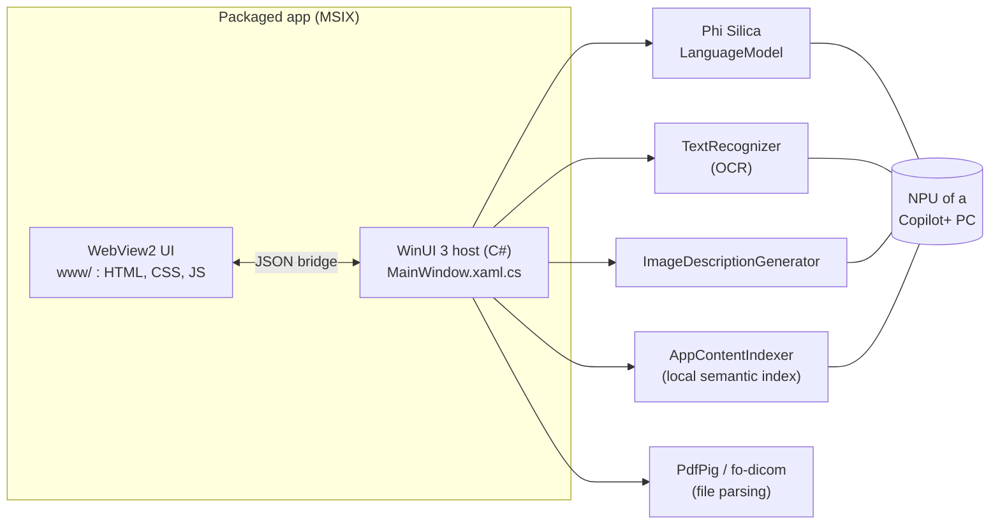
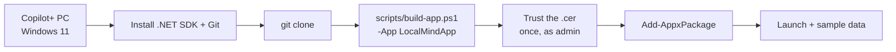

# On-device AI apps for Windows 11 (Copilot+ PC)

-0078D4)


Eleven small desktop apps whose AI runs **on the PC**, through the Windows AI APIs: the Phi Silica language model, on-device OCR, image description, and a local semantic index (`AppContentIndexer`). Each one shows what "the data stays on this device" can look like for an everyday business task: finance, fraud, HR, proof-of-execution audits, retail, radiology, personal knowledge.

> These are **demos and prototypes**, not products. All sample data is **synthetic**. Do not use the finance, fraud, HR or radiology apps to make real decisions.

## Architecture

Every app is the same shape: a WinUI 3 window hosting a WebView2 page, and a C# host that exposes the Windows AI APIs through a small JSON bridge.



The design rule behind most of them:

> **Code computes the facts, the model words them.** Totals, ratios, dates and verification matrices come from deterministic code (visible in Finance, Fraud, POE Verification); LocalIQ additionally checks the answer's numbers and citations against the retrieved text. The on-device model writes the explanation. Each app README says what is and is not checked.

Details: [`docs/ARCHITECTURE.md`](docs/ARCHITECTURE.md). To build a new app the same way, follow [`docs/BUILD-YOUR-OWN-APP.md`](docs/BUILD-YOUR-OWN-APP.md), or let Claude Code do it with the shareable skill in [`.claude/skills/windows-ondevice-ai-app/`](.claude/skills/windows-ondevice-ai-app/) (guide: [`docs/USE-THE-SKILL.md`](docs/USE-THE-SKILL.md)).

## Catalogue

| # | App | One line | Needs network? |
|---|---|---|---|
| 1 | [Finance Copilot](apps/FinanceCopilotApp) | Statement + payslip + ID scan → financial profile (income, expenses, DTI, anomalies), narrative and chat | No (font stylesheet only) |
| 2 | [Local Fraud Investigator](apps/FraudInvestigatorApp) | Transaction risk analysis, graph, cases, and policy Q&A over a local index | No (font stylesheet only) |
| 3 | [HR Recruiter Agent](apps/HRRecruiterApp) | Role + résumé fit analysis with evidence quotes, interview questions, duplicate detection | Only "fetch job posting from URL" |
| 4 | [POE Verification Analyst](apps/POEVerificationApp) | PO ↔ invoice ↔ proof-of-execution matrix, reuse detection, photo quantity estimate | No (font stylesheet only) |
| 5 | [POE Photo Processor](apps/POEPhotoProcessorApp) | Blur other people's faces, stamp EXIF date/location, AI caption, ZIP export | **Yes**: CDN libraries and OpenStreetMap geocoding |
| 6 | [AI Shelf Auditor](apps/AIShelfAuditorApp) | Retail shelf-execution assistant (React UI, on-device image description) | No |
| 7 | [Reading Room Assistant](apps/ReadingRoomAssistantApp) | Radiology reading-room **prototype** (preset AI findings; on-device draft impressions) | No (font stylesheet only) |
| 8 | [HybridMed](apps/HybridMedApp) | Lab triage: local structuring, then an optional cloud stage on **your** Azure endpoint | Only the cloud stage you configure |
| 9 | [LocalIQ](apps/LocalIQApp) | "Ask your files": any file type, hybrid retrieval, cited and verified answers | No |
| 10 | [LocalMind](apps/LocalMindApp) | Private ChatGPT-style assistant: chat, branches, memory, RAG, skills, images | No |
| 11 | [HybridMind](apps/HybridMindApp) | LocalMind + router: local first, **your** cloud model on consent, redaction, agent mode | Only the cloud/agent you configure (tested against a mock only) |

Each app folder has a README with a flow diagram, a source-file table, deployment command and a "Try it" list.

## Step by step: run an app



```powershell
# 1. tools (once)
winget install --id Microsoft.DotNet.SDK.8
winget install --id Git.Git

# 2. code
git clone https://github.com/medyabi/windows-local-ai-apps.git
cd windows-local-ai-apps

# 3. build a signed MSIX with a self-signed certificate that the script creates for you
.\scripts\build-app.ps1 -App LocalMindApp

# 4. trust that certificate (elevated PowerShell, once per PC)
Import-Certificate -FilePath .\dist\LocalMindApp\LocalMindApp.cer -CertStoreLocation Cert:\LocalMachine\TrustedPeople

# 5. install
Add-AppxPackage -Path (Get-ChildItem .\dist\LocalMindApp\*.msix).FullName
```

Then start the app from the Start menu. The full guide (checks, certificates, first launch, update/uninstall, troubleshooting) is [`docs/DEPLOYMENT.md`](docs/DEPLOYMENT.md). Build internals and the developer loop: [`docs/BUILD.md`](docs/BUILD.md).

No binaries are published here on purpose: you build with your own certificate, so nobody has to trust someone else's.

## Requirements

| | |
|---|---|
| OS | Windows 11, build 22621 or later, x64 |
| AI features | A PC that supports the Windows AI APIs: a **Copilot+ PC** with an NPU (Phi Silica, OCR, image description). Without it the apps start but report the model as unavailable. |
| Build | .NET SDK 8 or newer (built and tested with SDK 9.0 targeting `net8.0`); NuGet restores the Windows App SDK `2.2.2-experimental9` and `Microsoft.Windows.SDK.BuildTools 10.0.26100.4654`; internet for the first build |
| Not needed | Visual Studio, Developer Mode |

## Privacy and network behaviour (measured from the source, not promised)

The AI inference in every app is on-device. Beyond that:

| App | Outbound network use |
|---|---|
| Finance, Fraud, POE Verification, Reading Room, HR, HybridMed | A **Google Fonts stylesheet** is requested by the page (cosmetic; fonts fall back offline). Your data is not part of that request. |
| HR Recruiter | Plus: the page asks the host to download a job-posting URL **only when you use "fetch from URL"**. |
| POE Photo Processor | `face-api.js` + model weights, `exifr`, `JSZip` from CDNs; GPS coordinates (and typed addresses) sent to **OpenStreetMap Nominatim** for geocoding. Photos are not uploaded. |
| HybridMed | If you enter an Azure endpoint and key: the stage-1 structured output goes to **that** endpoint (a `fetch` from the page). |
| HybridMind | Cloud calls go **only** to the endpoint you configure, made by the host, after consent and redaction. Optional local agent on loopback. |
| Finance Copilot | Its "Prove it" panel is a **static statement** of the design (counters are fixed text), not a live network monitor. |
| AI Shelf Auditor, LocalIQ, LocalMind | None found in the source (the AI Shelf bundle is minified and was not audited line by line). |

Windows itself may download or update the on-device models (Windows Update).

## Repository structure

```
windows-local-ai-apps/
├── README.md              this file
├── LICENSE                MIT
├── THIRD-PARTY.md         third-party components and their licences
├── .claude/skills/windows-ondevice-ai-app/   Claude Code skill: idea -> complete on-device AI app
├── scripts/
│   └── build-app.ps1      build (and optionally install) any app with your own certificate
├── docs/
│   ├── DEPLOYMENT.md      step-by-step deployment guide + troubleshooting
│   ├── ARCHITECTURE.md    shell, bridge, shared files
│   ├── BUILD.md           build internals, developer loop
│   ├── BUILD-YOUR-OWN-APP.md  playbook to create a new on-device AI app the same way
│   ├── USE-THE-SKILL.md   step-by-step: install and use the Claude Code skill
│   └── WINDOWS-AI-LESSONS.md  things measured the hard way
└── apps/
    └── <App>/
        ├── README.md                  what it does, flow, source files, deploy, try it
        ├── <App>.csproj, Package.appxmanifest, app.manifest
        ├── App.xaml(.cs), MainWindow.xaml(.cs)   the host
        ├── *.cs                       engines (LocalIQ, LocalMind, HybridMind)
        ├── www/                       the UI
        └── sample-* / manual-test-documents      synthetic data
```

## Lessons from building them

[`docs/WINDOWS-AI-LESSONS.md`](docs/WINDOWS-AI-LESSONS.md): content moderation that returns an empty answer without an exception, the small context window, UI-thread deadlocks with the local index, splitting big JSON calls, and more.

## Licence

[MIT](LICENSE). Third-party components: [`THIRD-PARTY.md`](THIRD-PARTY.md).
