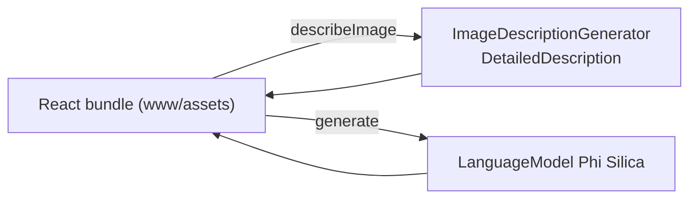

# AI Shelf Auditor

An on-device retail **shelf-execution** assistant. The UI is a React web app; the native shell gives it on-device image description and text generation.

## How it works



- Originally a React / Vite web demo; here it is wrapped in a native WinUI 3 + WebView2 shell that exposes three bridge ops: `ensureReady`, `generate`, `describeImage` (`HandleDescribeImageAsync`).
- `www/` contains the **built** (minified) bundle only. **The original React sources are not in this repository**, so changing the UI means rebuilding that web app elsewhere and copying its `dist` output into `www/`.
- I did not audit the bundle's screens line by line; it is described here only from its native interface.

## Source files

| File | What it contains |
|---|---|
| `MainWindow.xaml.cs` | The shell: virtual host `shelfauditor.local` → `www`, ops `ensureReady`, `generate`, `describeImage`. |
| `www/index.html`, `www/assets/index-*.js/css`, `www/*.svg` | Built React bundle (React, React Router, Redux Toolkit, Tailwind CSS output). |
| `Package.appxmanifest`, `*.csproj` | Packaging; capabilities `runFullTrust`, `systemAIModels`. |

## Deploy

```powershell
.\scripts\build-app.ps1 -App AIShelfAuditorApp -Install
```

Full guide: [`docs/DEPLOYMENT.md`](../../docs/DEPLOYMENT.md). Package name `MohamedDYABI.AIShelfAuditor`. No sample photos are included: use your own shelf pictures.

## Limits

Demo only. Third-party notice for the bundle: [`THIRD-PARTY.md`](../../THIRD-PARTY.md).
