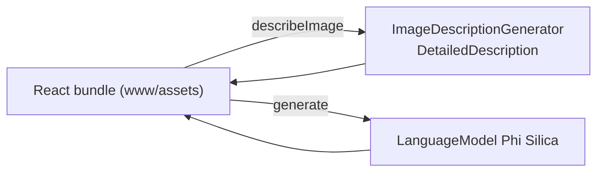

# AI Shelf Auditor

An on-device retail **shelf-execution** assistant. The UI is a React web app; the native shell gives it on-device image description and text generation.

## How it works



- Originally a React / Vite web demo; here it is wrapped in a native WinUI 3 + WebView2 shell that exposes three bridge ops: `ensureReady`, `generate`, `describeImage` (`HandleDescribeImageAsync`).
- `www/` contains the **built** (minified) bundle only. **The original React sources are not in this repository**, so changing the UI means rebuilding that web app elsewhere and copying its `dist` output into `www/`.
- I did not audit the bundle's screens line by line; it is described here only from its native interface.

## Source files

| File | What it contains |
|---|---|
| `MainWindow.xaml.cs` | The shell: virtual host `shelfauditor.local` → `www`, ops `ensureReady`, `generate`, `describeImage`. |
| `www/index.html`, `www/assets/index-*.js/css`, `www/*.svg` | Built React bundle (React, React Router, Redux Toolkit, Tailwind CSS output). |
| `Package.appxmanifest`, `*.csproj` | Packaging; capabilities `runFullTrust`, `systemAIModels`. |

## Step-by-step deployment

Everything below is copy-paste PowerShell on a Windows 11 PC. Replace nothing: the repository owner is `medyabi`.

**1. Check the PC and install the tools (once)**

- Windows 11 build 22621 or later, x64 (`winver`). For the AI features you need a Copilot+ PC (NPU); otherwise the app starts but reports the model as unavailable.

```powershell
winget install --id Microsoft.DotNet.SDK.8
winget install --id Git.Git
winget install --id GitHub.cli
```

**2. Sign in to GitHub and clone** (the repository is private, so the account must have access)

```powershell
gh auth login
git clone https://github.com/medyabi/windows-local-ai-apps.git
cd windows-local-ai-apps
```

**3. Build the signed package** (about 30 s to 2 min; the first build also downloads NuGet packages and needs internet)

```powershell
.\scripts\build-app.ps1 -App AIShelfAuditorApp
```

It creates a self-signed certificate if needed and writes two files: `dist\AIShelfAuditorApp\AIShelfAuditorApp_1.0.0.0_x64.msix` and `dist\AIShelfAuditorApp\AIShelfAuditorApp.cer`. A warning about `mspdbcmf.exe` is harmless.

**4. Trust the certificate** (PowerShell **as administrator**, once per PC)

```powershell
Import-Certificate -FilePath .\dist\AIShelfAuditorApp\AIShelfAuditorApp.cer -CertStoreLocation Cert:\LocalMachine\TrustedPeople
```

**5. Install**

```powershell
Add-AppxPackage -Path .\dist\AIShelfAuditorApp\AIShelfAuditorApp_1.0.0.0_x64.msix
```

**6. Launch** it from the Start menu (**AI Shelf Auditor**) or:

```powershell
$p = Get-AppxPackage *AIShelfAuditor*
Start-Process "shell:AppsFolder\$($p.PackageFamilyName)!App"
```

**7. First launch**

- The status pill shows the on-device model state. The first time, Windows may need to prepare the model (a few minutes, may need Windows Update).
- There are no sample photos in the repository: use your own shelf pictures.

**8. If something fails**

```powershell
$p = Get-AppxPackage *AIShelfAuditor*
notepad "$env:LOCALAPPDATA\Packages\$($p.PackageFamilyName)\LocalState\bridge.log"
```

Common errors and fixes are in [`docs/DEPLOYMENT.md`](../../docs/DEPLOYMENT.md#troubleshooting).

**9. Uninstall** (also removes the app's data)

```powershell
Get-AppxPackage *AIShelfAuditor* | Remove-AppxPackage
```

## Limits

Demo only. Third-party notice for the bundle: [`THIRD-PARTY.md`](../../THIRD-PARTY.md).
