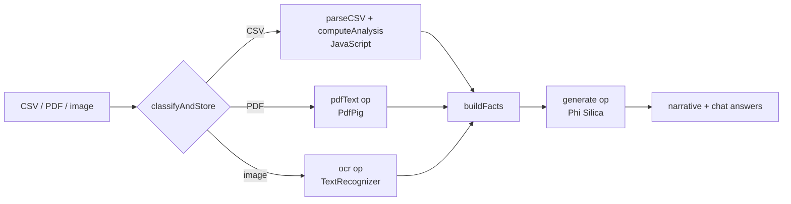

# Finance Copilot

Drop a customer's **bank statement (CSV)**, a **payslip / credit report (PDF)** and an **ID scan (image)**. The app builds a financial profile (income, expenses, savings, debt-to-income, anomalies) and lets you ask questions about it. The language model runs on the PC.

## How it works



- **Computed by code, never by the model:** `computeAnalysis` / `categorize` turn the statement into totals by category, average income and spending, DTI and anomalies.
- **The model only words** the result: `buildFacts` hands it the numbers, `callLocalNarrative` writes the summary, `callLocalChat` answers questions.
- Raw merchant and card strings are mapped to generic categories before they go into a prompt: the Windows content filter otherwise returns empty answers (see [`docs/WINDOWS-AI-LESSONS.md`](../../docs/WINDOWS-AI-LESSONS.md)).
- The **"Prove it"** panel is a static statement of the design (no API, no upload); its counters are not measured by instrumenting the network. The page does load a Google Fonts stylesheet (cosmetic).

## Source files

| File | What it contains |
|---|---|
| `FinanceCopilotApp.csproj`, `Package.appxmanifest`, `app.manifest`, `App.xaml(.cs)`, `MainWindow.xaml` | Standard shell, see [`docs/ARCHITECTURE.md`](../../docs/ARCHITECTURE.md). References PdfPig. |
| `MainWindow.xaml.cs` | Bridge ops `ensureReady`, `generate`, `pdfText` (PdfPig), `ocr` (`TextRecognizer`). |
| `www/index.html` | The whole UI and logic (HTML + CSS + JS in one file): `handleFiles` → `processFile` → `classifyAndStore`; `parseCSV`, `computeAnalysis`, `runAnalysis`, `renderProfile`; `buildFacts`, `callLocalNarrative`, `sendChatMessage`; the Prove-it modal. |
| `sample-data/` | Synthetic customers: statements (CSV), a payslip and a credit report (PDF), an ID card (PNG). |

## Deploy

Follow [`docs/DEPLOYMENT.md`](../../docs/DEPLOYMENT.md) with:

```powershell
.\scripts\build-app.ps1 -App FinanceCopilotApp -Install
```

Package name `MohamedDYABI.FinanceCopilot`.

## Try it

1. Launch the app, wait for the status pill *On-device model: ready*.
2. Click the demo loader (`loadDemo`) or drop files from `sample-data/` (e.g. `1_marco_rossi_statement.csv`, `3_ahmed_khalil_payslip.pdf`, `4_priya_sharma_id_card.png`).
3. Read the profile and narrative, then ask a question in the chat.

## Limits

Demo only: not for real credit decisions. Behaviour on real-world statement formats is untested.
