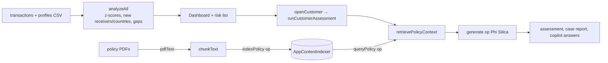

# Local Fraud Investigator

An on-device fraud / AML investigation assistant. Load transactions and customer profiles, see risk scores and a transaction graph, open a case, and ask questions against your **policy documents**. The language model and the policy index run on the PC.

## How it works



- **Deterministic analysis** in `app.js`: statistics (`avg`, `stddev`, `z`), first-time receivers/countries (`knownReceiversBefore`, `knownCountriesBefore`), time gaps, categories, a relationship graph (`renderGraph`).
- **Policy RAG:** policy documents are chunked and added to a local semantic index; the retrieved passages are put in the prompt so the answer cites the policy.
- **Natural-language query** (`runNLQuery` → `executeStructuredQuery`): the model turns a question into a structured filter that the code executes on the data.
- **Cases:** `createCase`, `generateReport`.

## Source files

| File | What it contains |
|---|---|
| `MainWindow.xaml.cs` | Bridge ops `ensureReady`, `generate`, `pdfText`, `ocr`, `indexPolicy`, `queryPolicy`. `GetPolicyIndex` creates the `AppContentIndexer`; index calls run in `Task.Run`. |
| `www/index.html` | UI shell with three views: Dashboard, Cases, Policy Library. |
| `www/app.js` | All logic (≈50 KB): CSV parsing, analysis, graph, cases, policy indexing/retrieval, copilot chat. |
| `www/sample-transactions.csv`, `www/customer-profiles.csv`, `www/policies/*.pdf` | Synthetic data loaded by `loadDemoDataset` / `loadDemoPolicies` (AML, KYC, transaction-monitoring and investigation-handbook policies). |
| `sample-data/` | The same kind of data as standalone files. |

## Step-by-step deployment

Everything below is copy-paste PowerShell on a Windows 11 PC. Replace nothing: the repository owner is `medyabi`.

**1. Check the PC and install the tools (once)**

- Windows 11 build 22621 or later, x64 (`winver`). For the AI features you need a Copilot+ PC (NPU); otherwise the app starts but reports the model as unavailable.

```powershell
winget install --id Microsoft.DotNet.SDK.8
winget install --id Git.Git
winget install --id GitHub.cli
```

**2. Sign in to GitHub and clone** (the repository is private, so the account must have access)

```powershell
gh auth login
git clone https://github.com/medyabi/windows-local-ai-apps.git
cd windows-local-ai-apps
```

**3. Build the signed package** (about 30 s to 2 min; the first build also downloads NuGet packages and needs internet)

```powershell
.\scripts\build-app.ps1 -App FraudInvestigatorApp
```

It creates a self-signed certificate if needed and writes two files: `dist\FraudInvestigatorApp\FraudInvestigatorApp_1.0.0.0_x64.msix` and `dist\FraudInvestigatorApp\FraudInvestigatorApp.cer`. A warning about `mspdbcmf.exe` is harmless.

**4. Trust the certificate** (PowerShell **as administrator**, once per PC)

```powershell
Import-Certificate -FilePath .\dist\FraudInvestigatorApp\FraudInvestigatorApp.cer -CertStoreLocation Cert:\LocalMachine\TrustedPeople
```

**5. Install**

```powershell
Add-AppxPackage -Path .\dist\FraudInvestigatorApp\FraudInvestigatorApp_1.0.0.0_x64.msix
```

**6. Launch** it from the Start menu (**Local Fraud Investigator**) or:

```powershell
$p = Get-AppxPackage *FraudInvestigator*
Start-Process "shell:AppsFolder\$($p.PackageFamilyName)!App"
```

**7. First launch**

- The status pill shows the on-device model state. The first time, Windows may need to prepare the model (a few minutes, may need Windows Update).
- Dashboard: load the demo dataset. Policy Library: load the demo policies, then wait a few seconds for the asynchronous index before asking policy questions.

**8. If something fails**

```powershell
$p = Get-AppxPackage *FraudInvestigator*
notepad "$env:LOCALAPPDATA\Packages\$($p.PackageFamilyName)\LocalState\bridge.log"
```

Common errors and fixes are in [`docs/DEPLOYMENT.md`](../../docs/DEPLOYMENT.md#troubleshooting).

**9. Uninstall** (also removes the app's data)

```powershell
Get-AppxPackage *FraudInvestigator* | Remove-AppxPackage
```

## Try it

1. Dashboard → load the demo dataset; open a high-risk customer and run the assessment.
2. Policy Library → load the demo policies (wait a few seconds: the index is asynchronous), then ask the copilot a policy question.
3. Create a case and generate its report.

## Limits

The local index is asynchronous and fuzzy; calling it directly from the UI thread deadlocks (see [`docs/WINDOWS-AI-LESSONS.md`](../../docs/WINDOWS-AI-LESSONS.md)). Synthetic data and demo policies only: not for real investigations. The page loads a Google Fonts stylesheet (cosmetic); transaction data is not sent anywhere.
