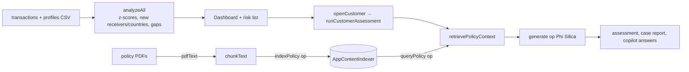

# Local Fraud Investigator

An on-device fraud / AML investigation assistant. Load transactions and customer profiles, see risk scores and a transaction graph, open a case, and ask questions against your **policy documents**. The language model and the policy index run on the PC.

## How it works



- **Deterministic analysis** in `app.js`: statistics (`avg`, `stddev`, `z`), first-time receivers/countries (`knownReceiversBefore`, `knownCountriesBefore`), time gaps, categories, a relationship graph (`renderGraph`).
- **Policy RAG:** policy documents are chunked and added to a local semantic index; the retrieved passages are put in the prompt so the answer cites the policy.
- **Natural-language query** (`runNLQuery` → `executeStructuredQuery`): the model turns a question into a structured filter that the code executes on the data.
- **Cases:** `createCase`, `generateReport`.

## Source files

| File | What it contains |
|---|---|
| `MainWindow.xaml.cs` | Bridge ops `ensureReady`, `generate`, `pdfText`, `ocr`, `indexPolicy`, `queryPolicy`. `GetPolicyIndex` creates the `AppContentIndexer`; index calls run in `Task.Run`. |
| `www/index.html` | UI shell with three views: Dashboard, Cases, Policy Library. |
| `www/app.js` | All logic (≈50 KB): CSV parsing, analysis, graph, cases, policy indexing/retrieval, copilot chat. |
| `www/sample-transactions.csv`, `www/customer-profiles.csv`, `www/policies/*.pdf` | Synthetic data loaded by `loadDemoDataset` / `loadDemoPolicies` (AML, KYC, transaction-monitoring and investigation-handbook policies). |
| `sample-data/` | The same kind of data as standalone files. |

## Deploy

```powershell
.\scripts\build-app.ps1 -App FraudInvestigatorApp -Install
```

Full guide: [`docs/DEPLOYMENT.md`](../../docs/DEPLOYMENT.md). Package name `MohamedDYABI.FraudInvestigator`.

## Try it

1. Dashboard → load the demo dataset; open a high-risk customer and run the assessment.
2. Policy Library → load the demo policies (wait a few seconds: the index is asynchronous), then ask the copilot a policy question.
3. Create a case and generate its report.

## Limits

The local index is asynchronous and fuzzy; calling it directly from the UI thread deadlocks (see [`docs/WINDOWS-AI-LESSONS.md`](../../docs/WINDOWS-AI-LESSONS.md)). Synthetic data and demo policies only: not for real investigations. The page loads a Google Fonts stylesheet (cosmetic); transaction data is not sent anywhere.
