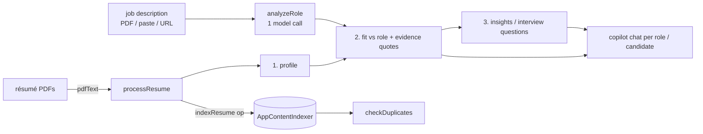

# HR Recruiter Agent

An on-device recruiting copilot: create a role from a job description, drop résumés, and get an **evidence-backed fit assessment** per candidate.

## How it works



- The work is deliberately **split into several small model calls** (`buildProfilePrompt`, `buildFitPrompt`, `buildInsightsPrompt`), each validated (`validateProfile`, `validateFit`, `validateInsights`, `extractJsonLoose`). One big combined call took about 8 minutes and truncated its JSON.
- Evidence: the fit assessment quotes résumé text; `renderCandidateProfile` shows it next to each requirement.
- **Duplicate detection** uses the local semantic index (`indexResume` / `queryResume`).
- A *Responsible AI* page states the limits.

## Source files

| File | What it contains |
|---|---|
| `MainWindow.xaml.cs` | Bridge ops `ensureReady`, `generate`, `pdfText`, `indexResume`, `queryResume`, `fetchUrl`. `HandleFetchUrlAsync` downloads a web page (HTML) with `HttpClient` because the browser's CORS rules would block it in the page. |
| `www/index.html` | UI: Dashboard, New Role, Roles, Responsible AI. |
| `www/app.js` | Logic (≈48 KB): prompts, validation, role/candidate rendering, duplicate check, copilot context builders. |
| `sample-test-documents/` | One job description and two synthetic résumés, with a README of expected results. |

## Step-by-step deployment

Everything below is copy-paste PowerShell on a Windows 11 PC. Replace nothing: the repository owner is `medyabi`.

**1. Check the PC and install the tools (once)**

- Windows 11 build 22621 or later, x64 (`winver`). For the AI features you need a Copilot+ PC (NPU); otherwise the app starts but reports the model as unavailable.

```powershell
winget install --id Microsoft.DotNet.SDK.8
winget install --id Git.Git
winget install --id GitHub.cli
```

**2. Sign in to GitHub and clone** (the repository is private, so the account must have access)

```powershell
gh auth login
git clone https://github.com/medyabi/windows-local-ai-apps.git
cd windows-local-ai-apps
```

**3. Build the signed package** (about 30 s to 2 min; the first build also downloads NuGet packages and needs internet)

```powershell
.\scripts\build-app.ps1 -App HRRecruiterApp
```

It creates a self-signed certificate if needed and writes two files: `dist\HRRecruiterApp\HRRecruiterApp_1.0.0.0_x64.msix` and `dist\HRRecruiterApp\HRRecruiterApp.cer`. A warning about `mspdbcmf.exe` is harmless.

**4. Trust the certificate** (PowerShell **as administrator**, once per PC)

```powershell
Import-Certificate -FilePath .\dist\HRRecruiterApp\HRRecruiterApp.cer -CertStoreLocation Cert:\LocalMachine\TrustedPeople
```

**5. Install**

```powershell
Add-AppxPackage -Path .\dist\HRRecruiterApp\HRRecruiterApp_1.0.0.0_x64.msix
```

**6. Launch** it from the Start menu (**HR Recruiter Agent**) or:

```powershell
$p = Get-AppxPackage *HRRecruiterAgent*
Start-Process "shell:AppsFolder\$($p.PackageFamilyName)!App"
```

**7. First launch**

- The status pill shows the on-device model state. The first time, Windows may need to prepare the model (a few minutes, may need Windows Update).
- Use the files in `sample-test-documents/`.
- Only the "fetch job description from URL" feature needs internet.

**8. If something fails**

```powershell
$p = Get-AppxPackage *HRRecruiterAgent*
notepad "$env:LOCALAPPDATA\Packages\$($p.PackageFamilyName)\LocalState\bridge.log"
```

Common errors and fixes are in [`docs/DEPLOYMENT.md`](../../docs/DEPLOYMENT.md#troubleshooting).

**9. Uninstall** (also removes the app's data)

```powershell
Get-AppxPackage *HRRecruiterAgent* | Remove-AppxPackage
```

## Try it

1. New Role → drop `sample-test-documents/JobDescription-SeniorCloudEngineer.pdf` → Analyze.
2. Open the role → drop the two sample résumés; compare the strong and weak fit.
3. Ask the copilot why a candidate was ranked as they were.

## Limits

- **One feature uses the network:** "fetch job description from URL" downloads that page. Everything else is local. The page also loads a Google Fonts stylesheet.
- Do not use the host's DevTools relay with this app: it crashed it regardless of load.
- A model must never be the only judge of a candidate: demo only.
