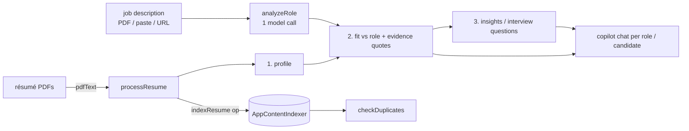

# HR Recruiter Agent

An on-device recruiting copilot: create a role from a job description, drop résumés, and get an **evidence-backed fit assessment** per candidate.

## How it works



- The work is deliberately **split into several small model calls** (`buildProfilePrompt`, `buildFitPrompt`, `buildInsightsPrompt`), each validated (`validateProfile`, `validateFit`, `validateInsights`, `extractJsonLoose`). One big combined call took about 8 minutes and truncated its JSON.
- Evidence: the fit assessment quotes résumé text; `renderCandidateProfile` shows it next to each requirement.
- **Duplicate detection** uses the local semantic index (`indexResume` / `queryResume`).
- A *Responsible AI* page states the limits.

## Source files

| File | What it contains |
|---|---|
| `MainWindow.xaml.cs` | Bridge ops `ensureReady`, `generate`, `pdfText`, `indexResume`, `queryResume`, `fetchUrl`. `HandleFetchUrlAsync` downloads a web page (HTML) with `HttpClient` because the browser's CORS rules would block it in the page. |
| `www/index.html` | UI: Dashboard, New Role, Roles, Responsible AI. |
| `www/app.js` | Logic (≈48 KB): prompts, validation, role/candidate rendering, duplicate check, copilot context builders. |
| `sample-test-documents/` | One job description and two synthetic résumés, with a README of expected results. |

## Deploy

```powershell
.\scripts\build-app.ps1 -App HRRecruiterApp -Install
```

Full guide: [`docs/DEPLOYMENT.md`](../../docs/DEPLOYMENT.md). Package name `MohamedDYABI.HRRecruiterAgent`.

## Try it

1. New Role → drop `sample-test-documents/JobDescription-SeniorCloudEngineer.pdf` → Analyze.
2. Open the role → drop the two sample résumés; compare the strong and weak fit.
3. Ask the copilot why a candidate was ranked as they were.

## Limits

- **One feature uses the network:** "fetch job description from URL" downloads that page. Everything else is local. The page also loads a Google Fonts stylesheet.
- Do not use the host's DevTools relay with this app: it crashed it regardless of load.
- A model must never be the only judge of a candidate: demo only.
