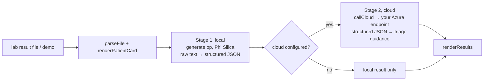

# HybridMed

A **hybrid pipeline** demo for lab-result triage: a local stage on the device, then a cloud stage **only if you configure one**.

## How it works



- **Stage 1 (local):** raw lab text (names, dates of birth, values, identifiers) is turned into structured JSON on the device. It replaces an earlier version that called Foundry Local over HTTP.
- **Stage 2 (cloud):** only the structured output of stage 1 is sent, to an **Azure AI Foundry** (OpenAI-compatible `chat/completions`) endpoint that you enter in the app's settings (`gpt-4.1-mini` in the demo). This is a real network call made **by the page itself** with `fetch`. The key is typed into a password field and kept only in the page's memory (it is not saved), so it must be re-entered each session.
- **Local chat:** `sendChatMessage` / `callLocalChat` answer questions on the device.
- Outside the native shell the page falls back to a Foundry Local endpoint on `127.0.0.1:60084` (development only).

No endpoint or key is included in this repository.

## Source files

| File | What it contains |
|---|---|
| `MainWindow.xaml.cs` | Ops `ensureReady`, `generate` only. |
| `www/index.html` | The whole app (≈45 KB, HTML+CSS+JS): `loadDemo`, `handleFile`, `parseFile`, `runPipeline`, `callLocal`, `callCloud`, `renderResults`, local chat, status check. |
| `Package.appxmanifest`, `*.csproj` | Packaging; capabilities `runFullTrust`, `systemAIModels`. |

## Deploy

```powershell
.\scripts\build-app.ps1 -App HybridMedApp -Install
```

Full guide: [`docs/DEPLOYMENT.md`](../../docs/DEPLOYMENT.md). Package name `MohamedDYABI.HybridMed`.

## Try it

1. Launch, click the demo loader (`loadDemo`) to load a synthetic lab report.
2. Run the pipeline without cloud settings to see the local stage.
3. (Optional) enter your Azure endpoint, deployment and key, run again to see the cloud stage.

## Limits

Synthetic data only; not for clinical use. The cloud stage was built for Azure AI Foundry; other providers are untested. The page loads a Google Fonts stylesheet (cosmetic).
