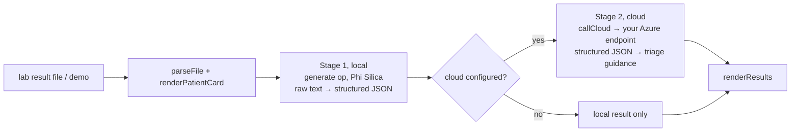

# HybridMed

A **hybrid pipeline** demo for lab-result triage: a local stage on the device, then a cloud stage **only if you configure one**.

## How it works



- **Stage 1 (local):** raw lab text (names, dates of birth, values, identifiers) is turned into structured JSON on the device. It replaces an earlier version that called Foundry Local over HTTP.
- **Stage 2 (cloud):** only the structured output of stage 1 is sent, to an **Azure AI Foundry** (OpenAI-compatible `chat/completions`) endpoint that you enter in the app's settings (`gpt-4.1-mini` in the demo). This is a real network call made **by the page itself** with `fetch`. The key is typed into a password field and kept only in the page's memory (it is not saved), so it must be re-entered each session.
- **Local chat:** `sendChatMessage` / `callLocalChat` answer questions on the device.
- Outside the native shell the page falls back to a Foundry Local endpoint on `127.0.0.1:60084` (development only).

No endpoint or key is included in this repository.

## Source files

| File | What it contains |
|---|---|
| `MainWindow.xaml.cs` | Ops `ensureReady`, `generate` only. |
| `www/index.html` | The whole app (≈45 KB, HTML+CSS+JS): `loadDemo`, `handleFile`, `parseFile`, `runPipeline`, `callLocal`, `callCloud`, `renderResults`, local chat, status check. |
| `Package.appxmanifest`, `*.csproj` | Packaging; capabilities `runFullTrust`, `systemAIModels`. |

## Step-by-step deployment

Everything below is copy-paste PowerShell on a Windows 11 PC. Replace nothing: the repository owner is `medyabi`.

**1. Check the PC and install the tools (once)**

- Windows 11 build 22621 or later, x64 (`winver`). For the AI features you need a Copilot+ PC (NPU); otherwise the app starts but reports the model as unavailable.

```powershell
winget install --id Microsoft.DotNet.SDK.8
winget install --id Git.Git
winget install --id GitHub.cli
```

**2. Sign in to GitHub and clone** (the repository is private, so the account must have access)

```powershell
gh auth login
git clone https://github.com/medyabi/windows-local-ai-apps.git
cd windows-local-ai-apps
```

**3. Build the signed package** (about 30 s to 2 min; the first build also downloads NuGet packages and needs internet)

```powershell
.\scripts\build-app.ps1 -App HybridMedApp
```

It creates a self-signed certificate if needed and writes two files: `dist\HybridMedApp\HybridMedApp_1.0.0.0_x64.msix` and `dist\HybridMedApp\HybridMedApp.cer`. A warning about `mspdbcmf.exe` is harmless.

**4. Trust the certificate** (PowerShell **as administrator**, once per PC)

```powershell
Import-Certificate -FilePath .\dist\HybridMedApp\HybridMedApp.cer -CertStoreLocation Cert:\LocalMachine\TrustedPeople
```

**5. Install**

```powershell
Add-AppxPackage -Path .\dist\HybridMedApp\HybridMedApp_1.0.0.0_x64.msix
```

**6. Launch** it from the Start menu (**HybridMed**) or:

```powershell
$p = Get-AppxPackage *HybridMed*
Start-Process "shell:AppsFolder\$($p.PackageFamilyName)!App"
```

**7. First launch**

- The status pill shows the on-device model state. The first time, Windows may need to prepare the model (a few minutes, may need Windows Update).
- The local stage works immediately. The cloud stage is optional: enter **your own** Azure AI Foundry endpoint, deployment and key in the settings; the key is kept in memory only and must be re-entered each session.

**8. If something fails**

```powershell
$p = Get-AppxPackage *HybridMed*
notepad "$env:LOCALAPPDATA\Packages\$($p.PackageFamilyName)\LocalState\bridge.log"
```

Common errors and fixes are in [`docs/DEPLOYMENT.md`](../../docs/DEPLOYMENT.md#troubleshooting).

**9. Uninstall** (also removes the app's data)

```powershell
Get-AppxPackage *HybridMed* | Remove-AppxPackage
```

## Try it

1. Launch, click the demo loader (`loadDemo`) to load a synthetic lab report.
2. Run the pipeline without cloud settings to see the local stage.
3. (Optional) enter your Azure endpoint, deployment and key, run again to see the cloud stage.

## Limits

Synthetic data only; not for clinical use. The cloud stage was built for Azure AI Foundry; other providers are untested. The page loads a Google Fonts stylesheet (cosmetic).
