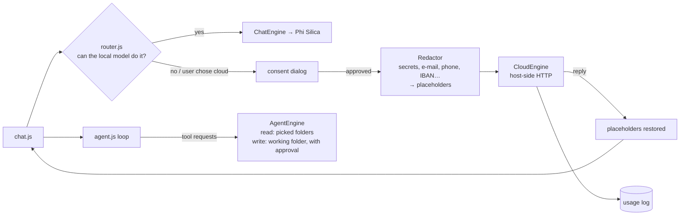

# HybridMind

[LocalMind](../LocalMindApp) plus a **router** and an **agent mode**: the on-device Windows AI model (Phi Silica) answers first, and **your own cloud model** (Azure OpenAI or any OpenAI-compatible endpoint) is used only when the task needs it, always visibly and with a way to say no.

> **Tested against a mock server only**, never against a real cloud service. Treat the cloud routing and the cloud agent as unproven until you try them with your own endpoint.

## How it works



- **The page has no network access.** Every cloud call is made by the C# host (`CloudEngine`), so the web UI cannot exfiltrate anything by itself. Redirects are not followed.
- **The API key** is stored encrypted with Windows DPAPI for the current user (`Secrets`); the page can save a key but never read it back, and the key is deleted if the endpoint address changes without a new key.
- **Redaction is pattern matching, not understanding** (`Redactor`): it replaces secrets, payment cards, e-mail, phone, IBAN and ID-like numbers with stable placeholders such as `[EMAIL_1]` and puts the originals back in the reply. It does **not** detect names, addresses, health details or confidential business text.
- **Agent mode** (`agent.js`, `AgentEngine`): a model plans and asks for tools; the host executes each tool and enforces the allowed folders. The loop can be driven by the cloud model or by a **local** OpenAI-compatible server on loopback (e.g. Foundry Local), which sends nothing off the machine.

## Source files

Everything in LocalMind (chat, files, skills, images; see its README), plus:

| File | What it adds |
|---|---|
| `CloudEngine.cs` | Cloud half: endpoint normalisation for Azure (project endpoint, v1 vs per-deployment API styles) and OpenAI-compatible servers, connection test, chat completions, usage accounting. |
| `Redactor.cs`, `Secrets.cs` | Deterministic redaction; DPAPI key storage. |
| `AgentEngine.cs` | Agent sessions, tool execution in the host, path checks, write approvals. |
| `www/js/router.js` | Routing policy: local first; what may leave the PC. |
| `www/js/hybrid-ui.js` | Per-chat route switch, cloud status, Settings → Cloud / Routing & privacy / Cloud usage. |
| `www/js/agent.js`, `agent-ui.js`, `agent-menu.js` | Agent loop, Settings → Agent (folders, working folder, limits), engine chooser. |
| `dev/` | Test scripts. E-mail addresses, the "API key" and the card number in them are **fake strings** used to test redaction. |

## Step-by-step deployment

Everything below is copy-paste PowerShell on a Windows 11 PC. Replace nothing: the repository owner is `medyabi`.

**1. Check the PC and install the tools (once)**

- Windows 11 build 22621 or later, x64 (`winver`). For the AI features you need a Copilot+ PC (NPU); otherwise the app starts but reports the model as unavailable.

```powershell
winget install --id Microsoft.DotNet.SDK.8
winget install --id Git.Git
winget install --id GitHub.cli
```

**2. Sign in to GitHub and clone** (the repository is private, so the account must have access)

```powershell
gh auth login
git clone https://github.com/medyabi/windows-local-ai-apps.git
cd windows-local-ai-apps
```

**3. Build the signed package** (about 30 s to 2 min; the first build also downloads NuGet packages and needs internet)

```powershell
.\scripts\build-app.ps1 -App HybridMindApp
```

It creates a self-signed certificate if needed and writes two files: `dist\HybridMindApp\HybridMindApp_1.2.0.0_x64.msix` and `dist\HybridMindApp\HybridMindApp.cer`. A warning about `mspdbcmf.exe` is harmless.

**4. Trust the certificate** (PowerShell **as administrator**, once per PC)

```powershell
Import-Certificate -FilePath .\dist\HybridMindApp\HybridMindApp.cer -CertStoreLocation Cert:\LocalMachine\TrustedPeople
```

**5. Install**

```powershell
Add-AppxPackage -Path .\dist\HybridMindApp\HybridMindApp_1.2.0.0_x64.msix
```

**6. Launch** it from the Start menu (**HybridMind by Dyabi**) or:

```powershell
$p = Get-AppxPackage Dyabi.HybridMind
Start-Process "shell:AppsFolder\$($p.PackageFamilyName)!App"
```

**7. First launch**

- The status pill shows the on-device model state. The first time, Windows may need to prepare the model (a few minutes, may need Windows Update).
- Without cloud settings it behaves like LocalMind. To use the cloud route, open Settings, Cloud, enter **your own** endpoint, deployment and key, and press Test connection. The cloud routing was tested against a mock server only.

**8. If something fails**

```powershell
$p = Get-AppxPackage Dyabi.HybridMind
notepad "$env:LOCALAPPDATA\Packages\$($p.PackageFamilyName)\LocalState\bridge.log"
```

Common errors and fixes are in [`docs/DEPLOYMENT.md`](../../docs/DEPLOYMENT.md#troubleshooting).

**9. Uninstall** (also removes the app's data)

```powershell
Get-AppxPackage Dyabi.HybridMind | Remove-AppxPackage
```

## Try it

1. Without any cloud settings it behaves like LocalMind.
2. Settings → Cloud: enter your endpoint, deployment and key; **Test connection**.
3. Send a message containing a fake e-mail address with the route set to cloud; check the consent dialog, the redaction, and Settings → Cloud usage.
