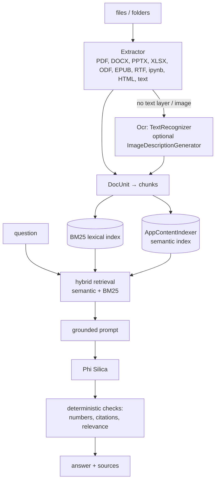

# LocalIQ

**Ask your files anything.** Documents, PDFs, notes, images and code are indexed on the PC and answered with citations by on-device Phi Silica. Works offline. (It supersedes an earlier "Offline Spec Sheet Q&A" app.)

## How it works



- **Hybrid retrieval:** semantic hits and BM25 keyword hits are merged, because each misses what the other finds (part numbers, exact figures).
- **Guards:** the answer's numbers are checked against the retrieved text, citations are verified, and irrelevant retrievals are refused (`verifyHtml`, `keysHtml` in the UI show the checks).
- Office files are read entry by entry from the zip (only the XML parts), so embedded media is never loaded and size does not matter; scanned PDFs are rendered with the Windows PDF renderer and OCR'd.

## Source files

| File | What it contains |
|---|---|
| `Engine.cs` (`SpecEngine`) | The whole backend: library store, indexing, `AppContentIndexer` use (always through `Task.Run`), tokenising + BM25, hybrid search, grounded prompt, verification. |
| `Extraction.cs` | `Extractor`: file-kind detection and text extraction per format; PDF line rebuild from word positions with ` | ` marking table columns; PdfPig. |
| `Ocr.cs` | `TextRecognizer` OCR and optional photo captioning from background threads; PDF page rendering for scanned PDFs. |
| `Models.cs` | Bridge DTOs (`BridgeRequest/Response`, `DocInfo`, `ChunkRec`, `Hit`, `AskResult`, `IndexStatus`…) and the JSON source-generation context. |
| `MainWindow.xaml.cs` | Bridge ops, model readiness, opening only files the library knows. Debug-only: a `selftest.json` in `LocalState` runs index → ask at start-up. |
| `www/index.html`, `www/app.js` | UI: library panel, scope selector, indexing progress, answer rendering with sources (`ask`, `renderLibrary`, `runIndex`, `formatAnswer`, `sourcesHtml`). |
| `tools/` | Python scripts that generated the **synthetic** samples and icons (`make_samples.py`, `make_samples_general.py`, `make_icons.py`). |
| `sample-datasheets/`, `sample-files/` | Invented component datasheets, and a mixed library: documents, a scanned PDF, a whiteboard photo, code, spreadsheets, slides. |

## Deploy

```powershell
.\scripts\build-app.ps1 -App LocalIQApp -Install
```

Full guide: [`docs/DEPLOYMENT.md`](../../docs/DEPLOYMENT.md). Package name `Dyabi.LocalIQ`.

## Try it

1. Add the `sample-files` (or `sample-datasheets`) folder to the library and wait for the progress bar to finish.
2. Ask a factual question, e.g. about a figure in an invoice or datasheet; open a source to see the highlighted line.
3. Turn on photo descriptions to include images that have no text.

## Limits

Works offline once the Windows model is ready; the index is asynchronous (the app polls its status). Small context window: very broad questions retrieve only a few passages.
