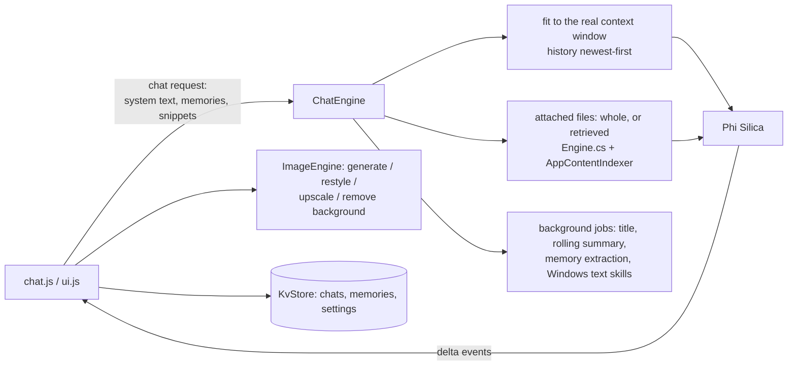

# LocalMind

A private **ChatGPT-style assistant that runs entirely on the PC**: streaming chat, conversation branches, memory, files (RAG), assistants and projects, built-in tools, skills, and on-device image features. Powered by Phi Silica; works offline.

## How it works



- **One model call at a time** (a shared NPU gate); background jobs yield to the user's next message.
- The **prompt is fitted to Phi Silica's measured context window** (a small one) and the stream is delta-based; see [`docs/WINDOWS-AI-LESSONS.md`](../../docs/WINDOWS-AI-LESSONS.md).
- **Tools run as plain code** in the page (`tools.js`: calculator without `eval`, unit conversion, date arithmetic, memory commands); their results are given to the model as exact facts.
- **Skills** are folders with a `SKILL.md` (name, description, instructions); they only add instructions to a prompt, nothing in them is executed.

## What's new in 1.2.1: asking for SKUs and part numbers

Asking "list the Datacenter SKUs" over a price list used to fail: the rows are spread across many near-identical passages, the word "SKU" appears only in the table *headers* (not in the rows), and the model's context holds only a handful of passages, so it received prose and the wrong pages and answered "I cannot assist you".

Now, when a question asks for SKUs, part numbers or codes, the app **scans every row of the selected files in code**, keeps the rows that mention everything you named (for example *Datacenter* and *ROK*), and gives them to the model as one compact, exact first excerpt:

- Words found in nearly every row ("Windows Server 2025") only rank rows; the words you named select them. If no row matches them all, it relaxes one word at a time.
- A broad question (for example only "Windows Server 2025 SKU") shows the first rows and says how many more exist, so it never pretends to be complete.
- A short follow-up such as "and for Standard?" keeps the intent but takes its own subject.
- Questions that are not about codes use the normal retrieval path, unchanged.
- Part numbers come from the document's text, copied exactly; the model is told never to invent or alter one. The Sources panel shows the matched rows whatever the model writes.

Limits: it needs a text layer or OCR text with codes that look like part numbers (letters and digits joined by hyphens, for example `AB1-0001`); a price list that prints an abbreviation (for example "DataCtr") is matched only for the aliases built in (`RowLookup.Alias`).

## Source files

| File | What it contains |
|---|---|
| `ChatEngine.cs`, `ChatModels.cs` | Chat turn: prompt fitting, retrieval from attached files, streaming events, reply clean-up, Windows text skills (summarise / rewrite / text-to-table), background jobs. |
| `Engine.cs`, `Extraction.cs`, `Ocr.cs` | File knowledge: library, extraction of many formats, chunking, local index (`AppContentIndexer`), OCR. Same design as LocalIQ. |
| `RowLookup.cs` | Deterministic **part-number / SKU row lookup** (see "What's new" below): finds the table rows that match what the question names, in code, with no model involved. No Windows dependencies, so it is unit-tested on its own (`tests/LocalMind.RowLookup.Tests`). |
| `ImageEngine.cs` | Windows AI `ImageGenerator`, `ImageScaler`, `ImageForegroundExtractor`; each model is downloaded by Windows on first use. |
| `SkillStore.cs`, `Store.cs` | Skills folder under `LocalState\skills`; atomic key→JSON file store for page data. |
| `Models.cs`, `MainWindow.xaml.cs` | DTOs and the bridge dispatcher. |
| `Probe.cs`, `SelfTest.cs` | **Debug-only**: probe of model behaviour (streaming, context length, speed) and an end-to-end self-test, triggered by files in `LocalState`. |
| `www/index.html`, `www/style.css` | UI shell and styling. |
| `www/js/` | `bridge.js` (JSON bridge), `main.js` (start-up), `ui.js` (state + rendering), `chat.js` (send/stream/regenerate/branches/slash commands), `panels.js` (settings, memory, library, assistants, projects, search, export/import), `prompt.js` (built-in assistants + system prompt), `tools.js`, `skills.js`, `skills-ui.js`, `store.js`, `md.js` (safe Markdown + code highlighting), `util.js`. |
| `dev/` | `mock.js` to preview the UI in a normal browser without the host; test scripts. |
| `tools/` | Python generators for synthetic samples and icons. |

## Step-by-step deployment

Everything below is copy-paste PowerShell on a Windows 11 PC. Replace nothing: the repository owner is `medyabi`.

**1. Check the PC and install the tools (once)**

- Windows 11 build 22621 or later, x64 (`winver`). For the AI features you need a Copilot+ PC (NPU); otherwise the app starts but reports the model as unavailable.

```powershell
winget install --id Microsoft.DotNet.SDK.8
winget install --id Git.Git
winget install --id GitHub.cli
```

**2. Sign in to GitHub and clone** (the repository is private, so the account must have access)

```powershell
gh auth login
git clone https://github.com/medyabi/windows-local-ai-apps.git
cd windows-local-ai-apps
```

**3. Build the signed package** (about 30 s to 2 min; the first build also downloads NuGet packages and needs internet)

```powershell
.\scripts\build-app.ps1 -App LocalMindApp
```

It creates a self-signed certificate if needed and writes two files: `dist\LocalMindApp\LocalMindApp_1.2.1.0_x64.msix` and `dist\LocalMindApp\LocalMindApp.cer`. A warning about `mspdbcmf.exe` is harmless.

**4. Trust the certificate** (PowerShell **as administrator**, once per PC)

```powershell
Import-Certificate -FilePath .\dist\LocalMindApp\LocalMindApp.cer -CertStoreLocation Cert:\LocalMachine\TrustedPeople
```

**5. Install**

```powershell
Add-AppxPackage -Path .\dist\LocalMindApp\LocalMindApp_1.2.1.0_x64.msix
```

**6. Launch** it from the Start menu (**LocalMind by Dyabi**) or:

```powershell
$p = Get-AppxPackage Dyabi.LocalMind
Start-Process "shell:AppsFolder\$($p.PackageFamilyName)!App"
```

**7. First launch**

- The status pill shows the on-device model state. The first time, Windows may need to prepare the model (a few minutes, may need Windows Update).
- Image features (generate, upscale, remove background) make Windows download a model on first use.

**8. If something fails**

```powershell
$p = Get-AppxPackage Dyabi.LocalMind
notepad "$env:LOCALAPPDATA\Packages\$($p.PackageFamilyName)\LocalState\bridge.log"
```

Common errors and fixes are in [`docs/DEPLOYMENT.md`](../../docs/DEPLOYMENT.md#troubleshooting).

**9. Uninstall** (also removes the app's data)

```powershell
Get-AppxPackage Dyabi.LocalMind | Remove-AppxPackage
```

## Try it

1. Say hello; watch the reply stream. Edit a message to create a branch.
2. Attach a file from `tools/`-generated samples or your own and ask about it.
3. Settings → Memory/Skills; try `/` commands; try image generation (first use downloads a Windows model).

## Limits

Image features need Windows-managed models that some PCs/OS builds do not offer (the app gives up with a message). Everything runs on a small on-device model: expect shorter, simpler answers than a cloud chatbot.
