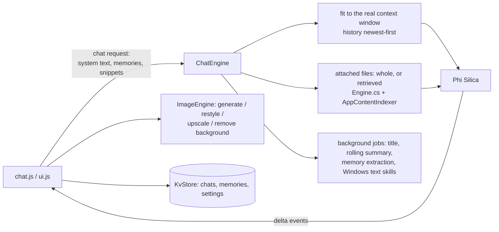

# LocalMind

A private **ChatGPT-style assistant that runs entirely on the PC**: streaming chat, conversation branches, memory, files (RAG), assistants and projects, built-in tools, skills, and on-device image features. Powered by Phi Silica; works offline.

## How it works



- **One model call at a time** (a shared NPU gate); background jobs yield to the user's next message.
- The **prompt is fitted to Phi Silica's measured context window** (a small one) and the stream is delta-based; see [`docs/WINDOWS-AI-LESSONS.md`](../../docs/WINDOWS-AI-LESSONS.md).
- **Tools run as plain code** in the page (`tools.js`: calculator without `eval`, unit conversion, date arithmetic, memory commands); their results are given to the model as exact facts.
- **Skills** are folders with a `SKILL.md` (name, description, instructions); they only add instructions to a prompt, nothing in them is executed.

## Source files

| File | What it contains |
|---|---|
| `ChatEngine.cs`, `ChatModels.cs` | Chat turn: prompt fitting, retrieval from attached files, streaming events, reply clean-up, Windows text skills (summarise / rewrite / text-to-table), background jobs. |
| `Engine.cs`, `Extraction.cs`, `Ocr.cs` | File knowledge: library, extraction of many formats, chunking, local index (`AppContentIndexer`), OCR. Same design as LocalIQ. |
| `ImageEngine.cs` | Windows AI `ImageGenerator`, `ImageScaler`, `ImageForegroundExtractor`; each model is downloaded by Windows on first use. |
| `SkillStore.cs`, `Store.cs` | Skills folder under `LocalState\skills`; atomic key→JSON file store for page data. |
| `Models.cs`, `MainWindow.xaml.cs` | DTOs and the bridge dispatcher. |
| `Probe.cs`, `SelfTest.cs` | **Debug-only**: probe of model behaviour (streaming, context length, speed) and an end-to-end self-test, triggered by files in `LocalState`. |
| `www/index.html`, `www/style.css` | UI shell and styling. |
| `www/js/` | `bridge.js` (JSON bridge), `main.js` (start-up), `ui.js` (state + rendering), `chat.js` (send/stream/regenerate/branches/slash commands), `panels.js` (settings, memory, library, assistants, projects, search, export/import), `prompt.js` (built-in assistants + system prompt), `tools.js`, `skills.js`, `skills-ui.js`, `store.js`, `md.js` (safe Markdown + code highlighting), `util.js`. |
| `dev/` | `mock.js` to preview the UI in a normal browser without the host; test scripts. |
| `tools/` | Python generators for synthetic samples and icons. |

## Deploy

```powershell
.\scripts\build-app.ps1 -App LocalMindApp -Install
```

Full guide: [`docs/DEPLOYMENT.md`](../../docs/DEPLOYMENT.md). Package name `Dyabi.LocalMind`.

## Try it

1. Say hello; watch the reply stream. Edit a message to create a branch.
2. Attach a file from `tools/`-generated samples or your own and ask about it.
3. Settings → Memory/Skills; try `/` commands; try image generation (first use downloads a Windows model).

## Limits

Image features need Windows-managed models that some PCs/OS builds do not offer (the app gives up with a message). Everything runs on a small on-device model: expect shorter, simpler answers than a cloud chatbot.
