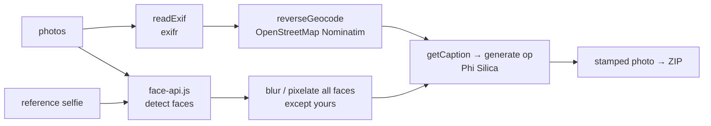

# POE Photo Processor

Processes event photos for proof-of-execution packs: **blurs the faces of other people** (not yours, via a reference selfie), **overlays EXIF date/time and location**, adds an **AI caption**, and exports a ZIP. It is a native rewrite of an earlier demo that talked to Foundry Local.

## How it works



- Face detection, blurring and the overlay run in the page (Canvas). Only the **caption** uses the Windows AI model, through the `generate` op (text only; the photo itself is not sent to the model).

## Network use: read this

Unlike most apps in this repository, this one **needs internet**:

- `face-api.js`, its model weights, `exifr` and `JSZip` are loaded from **CDNs** (jsDelivr, cdnjs).
- **Reverse geocoding** sends the photo's GPS latitude/longitude (and typed addresses for forward search) to **OpenStreetMap Nominatim**.
- The photos themselves are not uploaded.

To make it fully offline you would vendor those libraries and models into `www/` and replace or remove geocoding; that is not done here.

## Source files

| File | What it contains |
|---|---|
| `MainWindow.xaml.cs` | Bridge ops `ensureReady` and `generate` only. |
| `www/index.html` | The whole app (≈80 KB, HTML+CSS+JS): `handleFiles`, `readExif`, `loadModels`, `loadRef`, `processAll` / `processOne`, `getCaption`, `reverseGeocode`, `downloadZip`. When opened without the native shell it falls back to a Foundry Local HTTP endpoint. |
| `Package.appxmanifest` | Needs both device families (`Windows.Universal`, `Windows.Desktop`) for the AI API. |

## Step-by-step deployment

Everything below is copy-paste PowerShell on a Windows 11 PC. Replace nothing: the repository owner is `medyabi`.

**1. Check the PC and install the tools (once)**

- Windows 11 build 22621 or later, x64 (`winver`). For the AI features you need a Copilot+ PC (NPU); otherwise the app starts but reports the model as unavailable.

```powershell
winget install --id Microsoft.DotNet.SDK.8
winget install --id Git.Git
winget install --id GitHub.cli
```

**2. Sign in to GitHub and clone** (the repository is private, so the account must have access)

```powershell
gh auth login
git clone https://github.com/medyabi/windows-local-ai-apps.git
cd windows-local-ai-apps
```

**3. Build the signed package** (about 30 s to 2 min; the first build also downloads NuGet packages and needs internet)

```powershell
.\scripts\build-app.ps1 -App POEPhotoProcessorApp
```

It creates a self-signed certificate if needed and writes two files: `dist\POEPhotoProcessorApp\POEPhotoProcessorApp_1.0.0.0_x64.msix` and `dist\POEPhotoProcessorApp\POEPhotoProcessorApp.cer`. A warning about `mspdbcmf.exe` is harmless.

**4. Trust the certificate** (PowerShell **as administrator**, once per PC)

```powershell
Import-Certificate -FilePath .\dist\POEPhotoProcessorApp\POEPhotoProcessorApp.cer -CertStoreLocation Cert:\LocalMachine\TrustedPeople
```

**5. Install**

```powershell
Add-AppxPackage -Path .\dist\POEPhotoProcessorApp\POEPhotoProcessorApp_1.0.0.0_x64.msix
```

**6. Launch** it from the Start menu (**POE Photo Processor**) or:

```powershell
$p = Get-AppxPackage *POEPhotoProcessor*
Start-Process "shell:AppsFolder\$($p.PackageFamilyName)!App"
```

**7. First launch**

- The status pill shows the on-device model state. The first time, Windows may need to prepare the model (a few minutes, may need Windows Update).
- **This app needs internet**: it loads `face-api.js` and its models from a CDN and geocodes GPS coordinates through OpenStreetMap. Without internet, face detection does not start.
- There are no sample photos in the repository: bring your own, plus a selfie to exclude your own face from blurring.

**8. If something fails**

```powershell
$p = Get-AppxPackage *POEPhotoProcessor*
notepad "$env:LOCALAPPDATA\Packages\$($p.PackageFamilyName)\LocalState\bridge.log"
```

Common errors and fixes are in [`docs/DEPLOYMENT.md`](../../docs/DEPLOYMENT.md#troubleshooting).

**9. Uninstall** (also removes the app's data)

```powershell
Get-AppxPackage *POEPhotoProcessor* | Remove-AppxPackage
```

## Try it

1. Upload a selfie in the sidebar ("Your face: skip blur"), then some photos with people in them (use your own; there are no sample photos in this repository).
2. Adjust blur strength and face padding, click **Process All**.
3. Download one photo or the ZIP.
