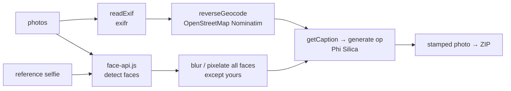

# POE Photo Processor

Processes event photos for proof-of-execution packs: **blurs the faces of other people** (not yours, via a reference selfie), **overlays EXIF date/time and location**, adds an **AI caption**, and exports a ZIP. It is a native rewrite of an earlier demo that talked to Foundry Local.

## How it works



- Face detection, blurring and the overlay run in the page (Canvas). Only the **caption** uses the Windows AI model, through the `generate` op (text only; the photo itself is not sent to the model).

## Network use: read this

Unlike most apps in this repository, this one **needs internet**:

- `face-api.js`, its model weights, `exifr` and `JSZip` are loaded from **CDNs** (jsDelivr, cdnjs).
- **Reverse geocoding** sends the photo's GPS latitude/longitude (and typed addresses for forward search) to **OpenStreetMap Nominatim**.
- The photos themselves are not uploaded.

To make it fully offline you would vendor those libraries and models into `www/` and replace or remove geocoding; that is not done here.

## Source files

| File | What it contains |
|---|---|
| `MainWindow.xaml.cs` | Bridge ops `ensureReady` and `generate` only. |
| `www/index.html` | The whole app (≈80 KB, HTML+CSS+JS): `handleFiles`, `readExif`, `loadModels`, `loadRef`, `processAll` / `processOne`, `getCaption`, `reverseGeocode`, `downloadZip`. When opened without the native shell it falls back to a Foundry Local HTTP endpoint. |
| `Package.appxmanifest` | Needs both device families (`Windows.Universal`, `Windows.Desktop`) for the AI API. |

## Deploy

```powershell
.\scripts\build-app.ps1 -App POEPhotoProcessorApp -Install
```

Full guide: [`docs/DEPLOYMENT.md`](../../docs/DEPLOYMENT.md). Package name `MohamedDYABI.POEPhotoProcessor`. The development signing key (`*_TemporaryKey.pfx`) is deliberately not in this repository.

## Try it

1. Upload a selfie in the sidebar ("Your face: skip blur"), then some photos with people in them (use your own; there are no sample photos in this repository).
2. Adjust blur strength and face padding, click **Process All**.
3. Download one photo or the ZIP.
