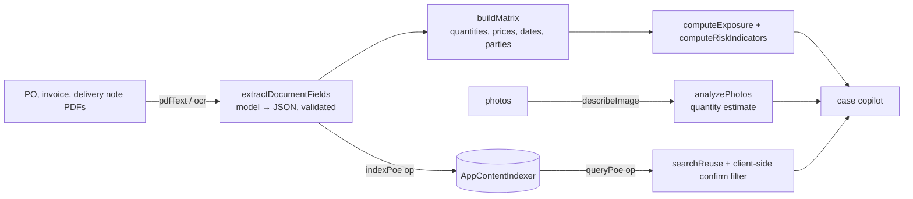

# POE Verification Analyst

On-device **proof-of-execution** verification: for each case it cross-checks the invoice against the purchase order and the delivery / execution evidence, flags exposure, and detects evidence reused across claims.

## How it works



- The **verification matrix is deterministic** (`buildMatrix`), the model only extracts fields (`buildExtractionPrompt`, `validateExtractedFields`, `coerceNumber`) and explains findings.
- **Reuse detection** needs a retry/delay because the index is asynchronous, and a client-side confirmation step because the index matches *fuzzily* (`reuseMatches`).
- Photo quantity estimation is a model estimate (`analyzePhotos`), shown as such.
- Supplier view: `supplierStats`, `renderSuppliers`.

## Source files

| File | What it contains |
|---|---|
| `MainWindow.xaml.cs` | Bridge ops `ensureReady`, `generate`, `pdfText`, `ocr`, `describeImage`, `indexPoe`, `queryPoe`; `DecodeImageBufferAsync`, `GetPoeIndex`. |
| `www/index.html` | UI: Dashboard, New Case, Cases, Suppliers, Local AI. |
| `www/app.js` | Logic (≈39 KB): extraction prompts and validation, matrix, exposure/risk, reuse search, supplier stats, copilot. |
| `manual-test-documents/` | Six synthetic scenarios + `generate.py` + README: clean, quantity over-billing, price inflation, execution shortfall, back-dated evidence, photo discrepancy. |

## Step-by-step deployment

Everything below is copy-paste PowerShell on a Windows 11 PC. Replace nothing: the repository owner is `medyabi`.

**1. Check the PC and install the tools (once)**

- Windows 11 build 22621 or later, x64 (`winver`). For the AI features you need a Copilot+ PC (NPU); otherwise the app starts but reports the model as unavailable.

```powershell
winget install --id Microsoft.DotNet.SDK.8
winget install --id Git.Git
winget install --id GitHub.cli
```

**2. Sign in to GitHub and clone** (the repository is private, so the account must have access)

```powershell
gh auth login
git clone https://github.com/medyabi/windows-local-ai-apps.git
cd windows-local-ai-apps
```

**3. Build the signed package** (about 30 s to 2 min; the first build also downloads NuGet packages and needs internet)

```powershell
.\scripts\build-app.ps1 -App POEVerificationApp
```

It creates a self-signed certificate if needed and writes two files: `dist\POEVerificationApp\POEVerificationApp_1.0.0.0_x64.msix` and `dist\POEVerificationApp\POEVerificationApp.cer`. A warning about `mspdbcmf.exe` is harmless.

**4. Trust the certificate** (PowerShell **as administrator**, once per PC)

```powershell
Import-Certificate -FilePath .\dist\POEVerificationApp\POEVerificationApp.cer -CertStoreLocation Cert:\LocalMachine\TrustedPeople
```

**5. Install**

```powershell
Add-AppxPackage -Path .\dist\POEVerificationApp\POEVerificationApp_1.0.0.0_x64.msix
```

**6. Launch** it from the Start menu (**POE Verification Analyst**) or:

```powershell
$p = Get-AppxPackage *POEVerification*
Start-Process "shell:AppsFolder\$($p.PackageFamilyName)!App"
```

**7. First launch**

- The status pill shows the on-device model state. The first time, Windows may need to prepare the model (a few minutes, may need Windows Update).
- Use the scenario folders in `manual-test-documents/` (supplier names are listed in its README). Extraction takes about 5-15 s per document.

**8. If something fails**

```powershell
$p = Get-AppxPackage *POEVerification*
notepad "$env:LOCALAPPDATA\Packages\$($p.PackageFamilyName)\LocalState\bridge.log"
```

Common errors and fixes are in [`docs/DEPLOYMENT.md`](../../docs/DEPLOYMENT.md#troubleshooting).

**9. Uninstall** (also removes the app's data)

```powershell
Get-AppxPackage *POEVerification* | Remove-AppxPackage
```

## Try it

1. New Case → type the supplier name from the table in `manual-test-documents/README.md` (e.g. *Atlas Logistics*) → drop that folder's `PO.pdf`, `Invoice.pdf`, `POE.pdf` → **Extract & Verify** (about 5–15 s per document).
2. Open the case: scenario 2 should show a quantity mismatch (PO 300 / invoice 340 / POE 300) and an exposure of about €8,000; scenario 1 should be clean.
3. In an open case use **Search for reused evidence**, ask the Investigation Copilot, and for scenario 6 click **Analyze photos with on-device AI**.

## Limits

Synthetic documents only; extraction quality on real paperwork is untested. The page loads a Google Fonts stylesheet (cosmetic).
