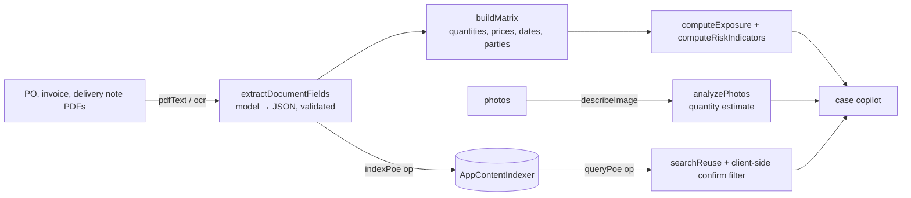

# POE Verification Analyst

On-device **proof-of-execution** verification: for each case it cross-checks the invoice against the purchase order and the delivery / execution evidence, flags exposure, and detects evidence reused across claims.

## How it works



- The **verification matrix is deterministic** (`buildMatrix`), the model only extracts fields (`buildExtractionPrompt`, `validateExtractedFields`, `coerceNumber`) and explains findings.
- **Reuse detection** needs a retry/delay because the index is asynchronous, and a client-side confirmation step because the index matches *fuzzily* (`reuseMatches`).
- Photo quantity estimation is a model estimate (`analyzePhotos`), shown as such.
- Supplier view: `supplierStats`, `renderSuppliers`.

## Source files

| File | What it contains |
|---|---|
| `MainWindow.xaml.cs` | Bridge ops `ensureReady`, `generate`, `pdfText`, `ocr`, `describeImage`, `indexPoe`, `queryPoe`; `DecodeImageBufferAsync`, `GetPoeIndex`. |
| `www/index.html` | UI: Dashboard, New Case, Cases, Suppliers, Local AI. |
| `www/app.js` | Logic (≈39 KB): extraction prompts and validation, matrix, exposure/risk, reuse search, supplier stats, copilot. |
| `manual-test-documents/` | Six synthetic scenarios + `generate.py` + README: clean, quantity over-billing, price inflation, execution shortfall, back-dated evidence, photo discrepancy. |

## Deploy

```powershell
.\scripts\build-app.ps1 -App POEVerificationApp -Install
```

Full guide: [`docs/DEPLOYMENT.md`](../../docs/DEPLOYMENT.md). Package name `MohamedDYABI.POEVerification`.

## Try it

1. New Case → type the supplier name from the table in `manual-test-documents/README.md` (e.g. *Atlas Logistics*) → drop that folder's `PO.pdf`, `Invoice.pdf`, `POE.pdf` → **Extract & Verify** (about 5–15 s per document).
2. Open the case: scenario 2 should show a quantity mismatch (PO 300 / invoice 340 / POE 300) and an exposure of about €8,000; scenario 1 should be clean.
3. In an open case use **Search for reused evidence**, ask the Investigation Copilot, and for scenario 6 click **Analyze photos with on-device AI**.

## Limits

Synthetic documents only; extraction quality on real paperwork is untested. The page loads a Google Fonts stylesheet (cosmetic).
