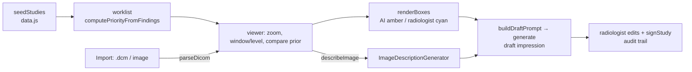

# Reading Room Assistant (prototype)

A human-in-the-loop **radiology reading-room prototype**: prioritised worklist, imaging viewer with AI and radiologist annotation layers, prior-study comparison, AI-drafted impression and a sign-off step.

> **Not a medical device. Never use for diagnosis.**
> The AI findings (regions, bounding boxes, confidence) are **pre-authored demo data** in `www/data.js`, standing in for a detection model that does not exist on the device. What is genuinely generated on the PC is the narrative: the image description and the **draft impression** (Phi Silica), grounded in that structured data.

## How it works



## Source files

| File | What it contains |
|---|---|
| `MainWindow.xaml.cs` | Ops `ensureReady`, `generate`, `describeImage`, `parseDicom` (fo-dicom: tags → age/sex/date, pixel data → preview PNG via ImageSharp). |
| `www/index.html` | UI: Worklist, Import Study, Dashboard, Responsible AI. |
| `www/app.js` | Worklist/priority logic, viewer (`renderViewer`, `wireStageInteraction`, `applyImgFilter`), side pane (findings, prior, impression, audit), prompts, sign-off, DICOM import. |
| `www/data.js` | Synthetic studies and the preset AI findings. |
| `www/images/*.png` | Synthetic images made by `image-gen/generate_images.py`. |
| `sample-import-data/` | `.dcm` samples (made with pydicom, no patient information) and PNGs to try *Import Study*. |

## Step-by-step deployment

Everything below is copy-paste PowerShell on a Windows 11 PC. Replace nothing: the repository owner is `medyabi`.

**1. Check the PC and install the tools (once)**

- Windows 11 build 22621 or later, x64 (`winver`). For the AI features you need a Copilot+ PC (NPU); otherwise the app starts but reports the model as unavailable.

```powershell
winget install --id Microsoft.DotNet.SDK.8
winget install --id Git.Git
winget install --id GitHub.cli
```

**2. Sign in to GitHub and clone** (the repository is private, so the account must have access)

```powershell
gh auth login
git clone https://github.com/medyabi/windows-local-ai-apps.git
cd windows-local-ai-apps
```

**3. Build the signed package** (about 30 s to 2 min; the first build also downloads NuGet packages and needs internet)

```powershell
.\scripts\build-app.ps1 -App ReadingRoomAssistantApp
```

It creates a self-signed certificate if needed and writes two files: `dist\ReadingRoomAssistantApp\ReadingRoomAssistantApp_1.0.0.0_x64.msix` and `dist\ReadingRoomAssistantApp\ReadingRoomAssistantApp.cer`. A warning about `mspdbcmf.exe` is harmless.

**4. Trust the certificate** (PowerShell **as administrator**, once per PC)

```powershell
Import-Certificate -FilePath .\dist\ReadingRoomAssistantApp\ReadingRoomAssistantApp.cer -CertStoreLocation Cert:\LocalMachine\TrustedPeople
```

**5. Install**

```powershell
Add-AppxPackage -Path .\dist\ReadingRoomAssistantApp\ReadingRoomAssistantApp_1.0.0.0_x64.msix
```

**6. Launch** it from the Start menu (**Reading Room Assistant**) or:

```powershell
$p = Get-AppxPackage *ReadingRoomAssistant*
Start-Process "shell:AppsFolder\$($p.PackageFamilyName)!App"
```

**7. First launch**

- The status pill shows the on-device model state. The first time, Windows may need to prepare the model (a few minutes, may need Windows Update).
- Prototype with synthetic studies; the AI findings are preset demo data. Import samples from `sample-import-data/`.

**8. If something fails**

```powershell
$p = Get-AppxPackage *ReadingRoomAssistant*
notepad "$env:LOCALAPPDATA\Packages\$($p.PackageFamilyName)\LocalState\bridge.log"
```

Common errors and fixes are in [`docs/DEPLOYMENT.md`](../../docs/DEPLOYMENT.md#troubleshooting).

**9. Uninstall** (also removes the app's data)

```powershell
Get-AppxPackage *ReadingRoomAssistant* | Remove-AppxPackage
```

## Try it

1. Worklist → open the chest study with a prior; switch between AI and radiologist layers, compare with the prior.
2. Generate the draft impression, edit it, and sign.
3. Import Study → `sample-import-data/chest-sample.dcm`.

The page loads a Google Fonts stylesheet (cosmetic).
