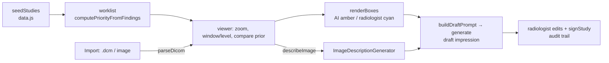

# Reading Room Assistant (prototype)

A human-in-the-loop **radiology reading-room prototype**: prioritised worklist, imaging viewer with AI and radiologist annotation layers, prior-study comparison, AI-drafted impression and a sign-off step.

> **Not a medical device. Never use for diagnosis.**
> The AI findings (regions, bounding boxes, confidence) are **pre-authored demo data** in `www/data.js`, standing in for a detection model that does not exist on the device. What is genuinely generated on the PC is the narrative: the image description and the **draft impression** (Phi Silica), grounded in that structured data.

## How it works



## Source files

| File | What it contains |
|---|---|
| `MainWindow.xaml.cs` | Ops `ensureReady`, `generate`, `describeImage`, `parseDicom` (fo-dicom: tags → age/sex/date, pixel data → preview PNG via ImageSharp). |
| `www/index.html` | UI: Worklist, Import Study, Dashboard, Responsible AI. |
| `www/app.js` | Worklist/priority logic, viewer (`renderViewer`, `wireStageInteraction`, `applyImgFilter`), side pane (findings, prior, impression, audit), prompts, sign-off, DICOM import. |
| `www/data.js` | Synthetic studies and the preset AI findings. |
| `www/images/*.png` | Synthetic images made by `image-gen/generate_images.py`. |
| `sample-import-data/` | `.dcm` samples (made with pydicom, no patient information) and PNGs to try *Import Study*. |

## Deploy

```powershell
.\scripts\build-app.ps1 -App ReadingRoomAssistantApp -Install
```

Full guide: [`docs/DEPLOYMENT.md`](../../docs/DEPLOYMENT.md). Package name `MohamedDYABI.ReadingRoomAssistant`. Third-party licences (fo-dicom MS-PL, ImageSharp Split License): [`THIRD-PARTY.md`](../../THIRD-PARTY.md); check the ImageSharp licence terms before any commercial use.

## Try it

1. Worklist → open the chest study with a prior; switch between AI and radiologist layers, compare with the prior.
2. Generate the draft impression, edit it, and sign.
3. Import Study → `sample-import-data/chest-sample.dcm`.

The page loads a Google Fonts stylesheet (cosmetic).
