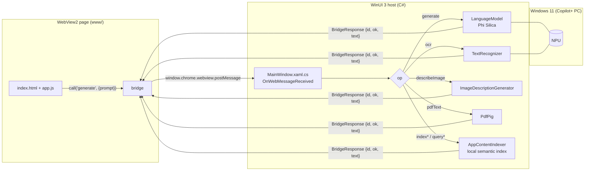

# Architecture shared by all apps

All eleven apps are the same kind of program: a **packaged WinUI 3 window that does nothing but host a WebView2 browser**, plus a C# "host" that exposes the Windows AI APIs to the web page through a tiny JSON bridge.

## The five things every app folder contains

| File | Role |
|---|---|
| `<App>.csproj` | Project: `net8.0-windows10.0.22621.0`, WinUI 3, `WindowsPackageType=MSIX`, self-contained Windows App SDK, `www\**` copied next to the exe, signing thumbprint. |
| `Package.appxmanifest` | **Package identity** (name, publisher, version), the `runFullTrust` and `systemAIModels` capabilities, and the two target device families (`Windows.Universal` + `Windows.Desktop`) that the Windows AI APIs need. |
| `app.manifest` | Win32 manifest (DPI awareness, OS compatibility). |
| `App.xaml` / `App.xaml.cs` | Application start-up: creates and activates `MainWindow`. |
| `MainWindow.xaml` / `MainWindow.xaml.cs` | One empty window containing a `WebView2`. **All native logic is in `MainWindow.xaml.cs`** (the bigger apps split it into engine files, see their READMEs). |
| `www/` | The UI: plain HTML/CSS/JavaScript (or a built web bundle for AI Shelf Auditor). Served to the WebView2 from a virtual host name (`https://<app>.local/index.html`) mapped to the `www` folder, so there is no file:// and no local web server. |

## The JSON bridge

Every app defines a small `NativeAI` object in JavaScript (in `app.js` or inline in `index.html`) with a `call(op, payload)` helper. The page posts `{ id, op, prompt, ... }`; the host handles it in `OnWebMessageReceived`, runs the Windows API and posts back `{ id, ok, text | error }`. The `id` pairs the answer with the waiting promise.

Operations used by the eight smaller apps (`case "..."` in `MainWindow.xaml.cs`):

| op | What the host does | Used by |
|---|---|---|
| `ensureReady` | Checks `LanguageModel.GetReadyState()` and, if needed, asks Windows to prepare the model; creates the `LanguageModel`. | all |
| `generate` | `LanguageModel.GenerateResponseAsync(prompt)` and returns the text. Windows' content moderation can return an empty answer without an exception: see [`WINDOWS-AI-LESSONS.md`](WINDOWS-AI-LESSONS.md). | all |
| `pdfText` | Extracts text from a PDF (base64 in) with PdfPig. | Finance, Fraud, POE Verification, HR |
| `ocr` | On-device OCR (`TextRecognizer`) of an image. | Finance, Fraud, POE Verification |
| `describeImage` | `ImageDescriptionGenerator` caption/description of a photo. | AI Shelf Auditor, POE Verification, Reading Room |
| `indexPolicy` / `queryPolicy`, `indexPoe` / `queryPoe`, `indexResume` / `queryResume` | Add text to, and search, a local semantic index (`AppContentIndexer`). Always run through `Task.Run` (calling it on the UI thread deadlocks). | Fraud, POE Verification, HR |
| `parseDicom` | Reads DICOM tags (fo-dicom) and renders a preview image. | Reading Room |
| `fetchUrl` | Downloads a web page's HTML (the only outbound request of that app, started by the user). | HR Recruiter |

LocalIQ, LocalMind and HybridMind have a much larger bridge (library, chat streaming, key-value store, skills, files, export/import). Their READMEs list the files.

## Design rules that recur

1. **Code computes, the model words.** Totals, ratios, dates, matrices and citations come from deterministic JavaScript/C#; the prompt gives the model these facts and asks it to explain them.
2. **Split large generations.** One big "return JSON with 10 fields" call is slow and gets truncated by the small context window; several small calls are faster and more reliable (HR Recruiter went from ~8 min to normal by doing this).
3. **Validate model JSON** (`extractJsonLoose`, `validate*` in the web apps) and fall back gracefully when the model returns nothing.
4. **Never log content.** `bridge.log` in `LocalState` records operation names and sizes, not prompts (the bigger apps are strict about this).
5. **Synthetic sample data only.**

## Where data lives on disk

Each installed app has `%LOCALAPPDATA%\Packages\<PackageFamilyName>\LocalState`, containing its stored data and `bridge.log`. Uninstalling the package removes it.
