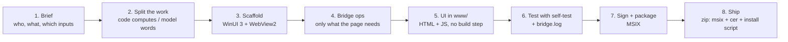

# Build your own on-device AI app for Windows 11 (Copilot+ PC)

A playbook distilled from the eleven apps in this repository. It describes **the recipe that worked every time**: what to create, in which order, which Windows AI API to call for which job, and which traps cost hours. Follow it top to bottom for a new app, or hand it to Claude Code as the brief (section 14).

> **Scope.** Everything here targets a **Copilot+ PC** (NPU, Windows 11 24H2 or later) and the Windows AI APIs shipped with the Windows App SDK `2.2.2-experimental9`. Those APIs are experimental: names, behaviour and limits can change. Re-check the lessons in [`WINDOWS-AI-LESSONS.md`](WINDOWS-AI-LESSONS.md) when you upgrade the SDK.

## Contents

1. [The recipe in one picture](#1-the-recipe-in-one-picture)
2. [Prerequisites](#2-prerequisites)
3. [Decide before you code](#3-decide-before-you-code)
4. [Scaffold the project](#4-scaffold-the-project)
5. [The host: `MainWindow.xaml.cs`](#5-the-host-mainwindowxamlcs)
6. [The page and the JSON bridge](#6-the-page-and-the-json-bridge)
7. [Windows AI recipes](#7-windows-ai-recipes)
8. [Prompt and design rules](#8-prompt-and-design-rules)
9. [Build, sign, install](#9-build-sign-install)
10. [The developer loop and testing](#10-the-developer-loop-and-testing)
11. [Traps: symptom, cause, fix](#11-traps-symptom-cause-fix)
12. [Growing the app](#12-growing-the-app)
13. [Definition of done](#13-definition-of-done)
14. [A brief to give Claude Code](#14-a-brief-to-give-claude-code)
15. [Reference apps](#15-reference-apps)

---

## 1. The recipe in one picture



The architecture never changes:

- A **packaged WinUI 3 window** that contains nothing but a `WebView2`.
- A **C# host** (`MainWindow.xaml.cs`) that exposes the Windows AI APIs to the page through a tiny JSON message bridge.
- A **plain HTML/CSS/JavaScript UI** in `www/`, served from a virtual host name (`https://<app>.local/`) mapped to that folder.

Why this shape: the UI can be iterated in a browser without touching C#, there is no local web server and no `file://`, and the AI calls stay on the device. Full diagram: [`ARCHITECTURE.md`](ARCHITECTURE.md).

---

## 2. Prerequisites

| Need | Detail |
|---|---|
| PC | Windows 11, x64, **Copilot+ PC** for Phi Silica (`LanguageModel`), OCR and image description. Without an NPU the APIs report `NotSupportedOnCurrentSystem`. |
| SDK | .NET 8 SDK or newer (a .NET 9 SDK builds the `net8.0` target fine). |
| Packages | `Microsoft.WindowsAppSDK 2.2.2-experimental9`, `Microsoft.Windows.SDK.BuildTools 10.0.26100.4654`, and `UglyToad.PdfPig` if you read PDFs. Pin exact versions. |
| Model | The language model is provisioned by Windows on first use (`EnsureReadyAsync`). It can take minutes, and image models took much longer on one PC (15+ minutes). Plan a first-run progress message. |
| Signing | A self-signed code-signing certificate, trusted in `Cert:\LocalMachine\TrustedPeople` (needs one elevated step). See section 9. |
| No Visual Studio | Not required. `dotnet build` produces the signed MSIX (section 9). |

---

## 3. Decide before you code

Answer these six questions in a short brief. Most rework in the earlier apps came from skipping one of them.

| # | Question | Why it matters |
|---|---|---|
| 1 | **Who uses it and what decision do they make?** | The UI and the wording of the model's output follow the decision, not the technology. |
| 2 | **What are the inputs?** (typed text, PDF, scanned PDF, photo, DICOM, CSV, a whole folder) | Each input type maps to one bridge op: `pdfText`, `ocr`, `describeImage`, an index. |
| 3 | **Which numbers or checks are deterministic?** | Those are computed by JavaScript or C#, never by the model (rule 1 in section 8). |
| 4 | **What exactly must the model write?** | Keep it to short explanations, summaries, drafts, classifications. Split anything long (rule 2). |
| 5 | **Is retrieval needed?** | If the corpus does not fit in one prompt, add `AppContentIndexer` plus your own ranking (section 7.5). |
| 6 | **Does anything leave the device?** | Default answer: no. If a cloud stage is needed, it is an explicit, consented, user-supplied endpoint (see HybridMed, HybridMind). |

If a spec is far larger than what a single on-device app can do (for example a multi-service backend with a database and trained models), **say so and re-scope before building**. For Fraud Investigator the detection engine became deterministic rules in JavaScript and the model only narrates; that was the right call. Ask the user to pick a scope option when the raw request is much bigger than the realistic build.

Also decide the **names** now, because they are painful to change later:

| Item | Example | Notes |
|---|---|---|
| Folder / assembly | `LocalIQApp` | Namespace equals the assembly name. |
| Package identity `Name` | `Dyabi.LocalIQ` | Letters, digits, dots. Different identity = separate install and separate data. |
| Display name | `LocalIQ by Dyabi` | What the user sees in Start. |
| Virtual host | `localiq.local` | One per app. |
| `Publisher` | `CN=YourName` | Must equal the certificate subject. |
| Version | `1.0.0.0` | Raise it to upgrade in place (keeps `LocalState`). |

---

## 4. Scaffold the project

Copy a small reference app (for example `FinanceCopilotApp`) and rename, or create these files.

```
MyApp/
├── MyApp.csproj
├── Package.appxmanifest          identity, capabilities, device families
├── app.manifest                  DPI awareness
├── App.xaml / App.xaml.cs        start-up
├── MainWindow.xaml / .xaml.cs    the WebView2 + all host logic
├── Assets/                       6 PNGs the manifest references
└── www/
    ├── index.html
    ├── style.css
    └── app.js
```

### 4.1 `MyApp.csproj`

```xml
<Project Sdk="Microsoft.NET.Sdk">
  <PropertyGroup>
    <OutputType>WinExe</OutputType>
    <TargetFramework>net8.0-windows10.0.22621.0</TargetFramework>
    <TargetPlatformMinVersion>10.0.22621.0</TargetPlatformMinVersion>
    <RootNamespace>MyApp</RootNamespace>
    <ApplicationManifest>app.manifest</ApplicationManifest>
    <Platforms>x64</Platforms>
    <RuntimeIdentifiers>win-x64</RuntimeIdentifiers>
    <UseWinUI>true</UseWinUI>
    <EnableMsixTooling>true</EnableMsixTooling>
    <WindowsPackageType>MSIX</WindowsPackageType>
    <WindowsAppSDKSelfContained>true</WindowsAppSDKSelfContained>
    <Nullable>enable</Nullable>
    <ImplicitUsings>enable</ImplicitUsings>
    <GenerateTestArtifacts>true</GenerateTestArtifacts>
    <AppxPackageSigningEnabled>true</AppxPackageSigningEnabled>
    <PackageCertificateThumbprint>YOUR-CERT-THUMBPRINT</PackageCertificateThumbprint>
    <AppxOSMinVersionReplaceManifestVersion>false</AppxOSMinVersionReplaceManifestVersion>
    <AppxOSMaxVersionTestedReplaceManifestVersion>false</AppxOSMaxVersionTestedReplaceManifestVersion>
  </PropertyGroup>

  <ItemGroup>
    <!-- the UI is copied next to the exe; exclude generators and sample data you do not ship -->
    <Content Include="www\**\*"><CopyToOutputDirectory>PreserveNewest</CopyToOutputDirectory></Content>
  </ItemGroup>
  <ItemGroup><Manifest Include="$(ApplicationManifest)" /></ItemGroup>

  <ItemGroup>
    <PackageReference Include="Microsoft.WindowsAppSDK" Version="2.2.2-experimental9" />
    <PackageReference Include="Microsoft.Windows.SDK.BuildTools" Version="10.0.26100.4654" />
    <PackageReference Include="UglyToad.PdfPig" Version="1.7.0-custom-5" /> <!-- only if you read PDFs -->
  </ItemGroup>
</Project>
```

### 4.2 `Package.appxmanifest` (the part that matters)

```xml
<Package xmlns="http://schemas.microsoft.com/appx/manifest/foundation/windows10"
         xmlns:mp="http://schemas.microsoft.com/appx/2014/phone/manifest"
         xmlns:uap="http://schemas.microsoft.com/appx/manifest/uap/windows10"
         xmlns:rescap="http://schemas.microsoft.com/appx/manifest/foundation/windows10/restrictedcapabilities"
         xmlns:systemai="http://schemas.microsoft.com/appx/manifest/systemai/windows10"
         IgnorableNamespaces="uap rescap systemai">

  <Identity Name="YourName.MyApp" Publisher="CN=YourName" Version="1.0.0.0" />
  <mp:PhoneIdentity PhoneProductId="NEW-GUID-HERE" PhonePublisherId="00000000-0000-0000-0000-000000000000"/>

  <Properties>
    <DisplayName>My App</DisplayName>
    <PublisherDisplayName>YourName</PublisherDisplayName>
    <Logo>Assets\StoreLogo.png</Logo>
  </Properties>

  <Dependencies>
    <!-- BOTH families are needed, otherwise the Windows AI APIs do not work -->
    <TargetDeviceFamily Name="Windows.Universal" MinVersion="10.0.17763.0" MaxVersionTested="10.0.26226.0" />
    <TargetDeviceFamily Name="Windows.Desktop"   MinVersion="10.0.22621.0" MaxVersionTested="10.0.26226.0" />
  </Dependencies>

  <Resources><Resource Language="en-us"/></Resources>

  <Applications>
    <Application Id="App" Executable="$targetnametoken$.exe" EntryPoint="Windows.FullTrustApplication">
      <uap:VisualElements DisplayName="My App" Description="What it does, on-device"
        BackgroundColor="transparent"
        Square150x150Logo="Assets\Square150x150Logo.png" Square44x44Logo="Assets\Square44x44Logo.png">
        <uap:DefaultTile Wide310x150Logo="Assets\Wide310x150Logo.png" />
        <uap:SplashScreen Image="Assets\SplashScreen.png" />
      </uap:VisualElements>
    </Application>
  </Applications>

  <Capabilities>
    <rescap:Capability Name="runFullTrust" />
    <systemai:Capability Name="systemAIModels" />   <!-- the on-device model capability -->
  </Capabilities>
</Package>
```

Non-negotiable points:

- **Package identity is mandatory.** Without it `ApplicationData.Current` throws and the `Microsoft.Windows.AI.*` APIs are unreliable. This is why a raw `.exe` does not work (section 10).
- **Both** `Windows.Universal` and `Windows.Desktop` device families, from the first commit.
- The `systemAIModels` capability. `AppContentIndexer` needed no extra capability.
- Generate a fresh `PhoneProductId` GUID per app.
- Six PNGs in `Assets/`. Generate them with a small script (Pillow) so a rename or recolour is one command; keep that script out of the package (`tools/`, not `www/`).

### 4.3 `app.manifest`

Copy it from any reference app. It sets `asInvoker`, the Windows 10/11 `supportedOS` GUIDs and `PerMonitorV2` DPI awareness. Change only the `assemblyIdentity name`.

### 4.4 `App.xaml`, `App.xaml.cs`, `MainWindow.xaml`

```xml
<!-- App.xaml -->
<Application x:Class="MyApp.App"
    xmlns="http://schemas.microsoft.com/winfx/2006/xaml/presentation"
    xmlns:x="http://schemas.microsoft.com/winfx/2006/xaml">
  <Application.Resources>
    <ResourceDictionary>
      <ResourceDictionary.MergedDictionaries>
        <XamlControlsResources xmlns="using:Microsoft.UI.Xaml.Controls" />
      </ResourceDictionary.MergedDictionaries>
    </ResourceDictionary>
  </Application.Resources>
</Application>
```

```csharp
// App.xaml.cs
using Microsoft.UI.Xaml;
namespace MyApp;
public partial class App : Application
{
    private Window? _window;
    public App() { InitializeComponent(); }
    protected override void OnLaunched(LaunchActivatedEventArgs args)
    { _window = new MainWindow(); _window.Activate(); }
}
```

```xml
<!-- MainWindow.xaml -->
<Window x:Class="MyApp.MainWindow"
    xmlns="http://schemas.microsoft.com/winfx/2006/xaml/presentation"
    xmlns:x="http://schemas.microsoft.com/winfx/2006/xaml"
    xmlns:controls="using:Microsoft.UI.Xaml.Controls">
  <Grid><controls:WebView2 x:Name="Web" /></Grid>
</Window>
```

---

## 5. The host: `MainWindow.xaml.cs`

The host does five things: log, create the WebView2, map the virtual host, receive bridge messages, answer them. The skeleton below is the pattern used by every app, with the two improvements learned later (check the model status; never log content).

```csharp
using System.Text.Json;
using System.Text.Json.Serialization;
using Microsoft.UI.Xaml;
using Microsoft.Web.WebView2.Core;
using Microsoft.Windows.AI;
using Microsoft.Windows.AI.Text;
using Windows.Storage;

namespace MyApp;

public sealed partial class MainWindow : Window
{
    private LanguageModel? _model;                       // create once, reuse
    private static readonly string LogPath =
        Path.Combine(ApplicationData.Current.LocalFolder.Path, "bridge.log");

    // Log operation names, sizes and statuses. NEVER prompts, documents or keys.
    private static void Log(string msg)
    { try { File.AppendAllText(LogPath, $"{DateTime.Now:HH:mm:ss.fff} {msg}\n"); } catch { } }

    public MainWindow()
    {
        InitializeComponent();
        Title = "My App - on-device AI";
        InitWebViewAsync();
    }

    private async void InitWebViewAsync()
    {
        try
        {
            await Web.EnsureCoreWebView2Async();
            var www = Path.Combine(AppContext.BaseDirectory, "www");
            Web.CoreWebView2.SetVirtualHostNameToFolderMapping(
                "myapp.local", www, CoreWebView2HostResourceAccessKind.Allow);
            Web.CoreWebView2.WebMessageReceived += OnWebMessageReceived;
            Web.CoreWebView2.Navigate("https://myapp.local/index.html");
        }
        catch (Exception ex) { Log("InitWebViewAsync EXCEPTION: " + ex); }
    }

    private async void OnWebMessageReceived(CoreWebView2 sender, CoreWebView2WebMessageReceivedEventArgs args)
    {
        BridgeRequest? req;
        try { req = JsonSerializer.Deserialize(args.WebMessageAsJson, BridgeJsonContext.Default.BridgeRequest); }
        catch (Exception ex) { Log("Deserialize EXCEPTION: " + ex.Message); return; }
        if (req is null) return;

        Log($"IN type={req.Type} promptLen={req.Prompt?.Length ?? 0} b64Len={req.Base64?.Length ?? 0}");
        var resp = new BridgeResponse { Id = req.Id };
        try
        {
            resp = req.Type switch
            {
                "ensureReady" => await HandleEnsureReadyAsync(req.Id),
                "generate"    => await HandleGenerateAsync(req.Id, req.Prompt ?? ""),
                // "pdfText"  => HandlePdfText(req.Id, req.Base64 ?? ""),
                // "ocr"      => await HandleOcrAsync(req.Id, req.Base64 ?? ""),
                // "indexDoc" => await Task.Run(() => HandleIndex(req.Id, req.ContentId ?? "", req.Prompt ?? "")), // see 7.5
                _ => new BridgeResponse { Id = req.Id, Ok = false, Error = "Unknown request type: " + req.Type },
            };
        }
        catch (Exception ex) { Log("Handler EXCEPTION: " + ex); resp.Ok = false; resp.Error = ex.Message; }

        Web.CoreWebView2.PostWebMessageAsJson(
            JsonSerializer.Serialize(resp, BridgeJsonContext.Default.BridgeResponse));
    }

    private async Task<BridgeResponse> HandleEnsureReadyAsync(string id)
    {
        var resp = new BridgeResponse { Id = id };
        var state = LanguageModel.GetReadyState();
        if (state == AIFeatureReadyState.NotReady)
        {
            var ensure = await LanguageModel.EnsureReadyAsync();       // downloads/prepares the model
            if (ensure.Status != AIFeatureReadyResultState.Success)
            { resp.Error = "Model setup failed: " + ensure.Status; return resp; }
            state = LanguageModel.GetReadyState();
        }
        resp.State = state.ToString();
        resp.Ok = state == AIFeatureReadyState.Ready;
        if (!resp.Ok)
            resp.Error = state switch
            {
                AIFeatureReadyState.DisabledByUser => "The on-device AI model is disabled. Enable it in Settings > System > AI components.",
                AIFeatureReadyState.NotSupportedOnCurrentSystem => "This PC's hardware does not support the on-device language model.",
                _ => "Model not ready: " + state,
            };
        return resp;
    }

    private async Task<BridgeResponse> HandleGenerateAsync(string id, string prompt)
    {
        var resp = new BridgeResponse { Id = id };
        if (LanguageModel.GetReadyState() != AIFeatureReadyState.Ready)
        { var ready = await HandleEnsureReadyAsync(id); if (!ready.Ok) return ready; }

        _model ??= await LanguageModel.CreateAsync();
        var result = await _model.GenerateResponseAsync(prompt);
        Log($"generate promptLen={prompt.Length} textLen={result.Text?.Length ?? 0} status={result.Status}");

        // A blocked or oversized prompt comes back as EMPTY TEXT with a status, not as an exception.
        if (string.IsNullOrEmpty(result.Text))
        { resp.Error = "Model returned no text (status: " + result.Status + ")"; return resp; }

        resp.Ok = true; resp.Text = result.Text;
        return resp;
    }
}

public sealed class BridgeRequest
{
    [JsonPropertyName("id")]       public string Id { get; set; } = "";
    [JsonPropertyName("type")]     public string Type { get; set; } = "";
    [JsonPropertyName("prompt")]   public string? Prompt { get; set; }
    [JsonPropertyName("base64")]   public string? Base64 { get; set; }
    [JsonPropertyName("contentId")] public string? ContentId { get; set; }
}

public sealed class BridgeResponse
{
    [JsonPropertyName("id")]    public string Id { get; set; } = "";
    [JsonPropertyName("ok")]    public bool Ok { get; set; }
    [JsonPropertyName("text")]  public string? Text { get; set; }
    [JsonPropertyName("state")] public string? State { get; set; }
    [JsonPropertyName("error")] public string? Error { get; set; }
}

[JsonSerializable(typeof(BridgeRequest))]
[JsonSerializable(typeof(BridgeResponse))]
internal partial class BridgeJsonContext : JsonSerializerContext { }
```

Rules for the host:

1. **One handler per op**, each returning a `BridgeResponse`. The top-level `try/catch` turns any exception into `{ ok:false, error }` so the page never waits forever.
2. **Reuse** `LanguageModel`, `TextRecognizer`, `ImageDescriptionGenerator` instances (creation has a cost).
3. **Log sizes and statuses only.** Two apps once logged 400 characters of every incoming message to `bridge.log`; in HybridMind that wrote an API key in plain text (found and fixed). Treat `bridge.log` as something a user may attach to a bug report.
4. Add new fields to `BridgeRequest` (`ContentId`, `N`, …) rather than new message formats.
5. Anything slow or thread-sensitive goes through `Task.Run` (7.5).

---

## 6. The page and the JSON bridge

The page talks to the host through `window.chrome.webview`. Every app contains this same small object; copy it into `www/app.js` (or `bridge.js` in the bigger apps).

```js
const NativeAI = (() => {
  const native = !!(window.chrome && window.chrome.webview);
  const pending = new Map();
  let counter = 0;
  if (native) {
    window.chrome.webview.addEventListener('message', (e) => {
      const msg = e.data;
      if (!msg || !msg.id || !pending.has(msg.id)) return;
      const { resolve, reject } = pending.get(msg.id);
      pending.delete(msg.id);
      if (msg.ok) resolve(msg); else reject(new Error(msg.error || 'Native AI error'));
    });
  }
  function call(type, extra) {
    if (!native) return Promise.reject(new Error('Open the installed desktop app to use on-device AI.'));
    const id = 't' + (++counter) + '_' + Date.now();
    return new Promise((resolve, reject) => {
      pending.set(id, { resolve, reject });
      window.chrome.webview.postMessage(Object.assign({ id, type }, extra));
    });
  }
  return {
    isNative: native,
    ensureReady: ()        => call('ensureReady'),
    generate:    (prompt)  => call('generate', { prompt }),
    pdfText:     (base64)  => call('pdfText', { base64 }),
    ocr:         (base64)  => call('ocr', { base64 }),
  };
})();
```

Page rules:

- **Reading a file**: use `FileReader` / `arrayBuffer()` in the page and send base64 to the host. No file system access from the host is needed for uploads.
- **Content-Security-Policy.** The larger apps ship `connect-src 'none'` so the page cannot call out; only the host may use the network (see `LocalMindApp/www/index.html`). Do this unless you have a reason not to.
- **Work without the host.** `NativeAI.isNative === false` in a normal browser. Provide a mock (`dev/mock.js`) so you can iterate on the UI in the browser pane with fake answers. Exclude `dev/` from the package.
- **Show state honestly.** Show "preparing the on-device model" on first run, a visible error when `generate` fails, and never present a model estimate as a measured fact.
- **No build step by default.** Vanilla JS, CSS custom properties, one file per concern once `app.js` passes ~1,500 lines (`util`, `bridge`, `ui`, `chat`, …). AI Shelf Auditor is the exception: a React/Vite app whose build output is wrapped by the same host.

---

## 7. Windows AI recipes

Pattern for every Windows AI feature: **check `GetReadyState()` → if `NotReady`, `EnsureReadyAsync()` → create once → call → check the status**.

### 7.1 Text generation (Phi Silica, `LanguageModel`)

Code above (section 5). Additional measured behaviour:

- `GenerateResponseAsync(prompt)` can return **empty text with a status** instead of throwing: `PromptBlockedByContentModeration`, `PromptLargerThanContext`. Always surface `result.Status`.
- The context window is small. About 5,900 characters of raw transactions overflowed it; about 6,000 characters of cleaner text did not. Cap what you send and prefer facts over raw text.
- `GetUsablePromptLength(context, prompt)` is a **fit test** (it returns the prompt length when the prompt fits), not a capacity number. A loop that shrinks the prompt until it fits is worth having (`LocalMindApp/ChatEngine.cs`).
- Prefill is slow: roughly 3,000 characters of excerpts took 5 to 8 seconds before the first token. Keep budgets modest (LocalMind uses a max prompt of about 7,500 characters including the system prompt).
- Default decoding is **deterministic**. "Regenerate" gives the identical answer unless you raise the temperature through the options (LocalMind uses 0.8).
- Streaming: the `Progress` callback of the async operation delivers **deltas**. Build the UI by appending. `op.Cancel()` stops generation; keep the partial text.
- A native `LanguageModelContext` remembers turns, but editing or branching a conversation needs a stateless transcript prompt (system text in `CreateContext(system)`, then "Conversation so far… User: / Assistant:"). Cut stop sequences like `\nUser:` from the output.
- Windows also ships ready-made text skills built on the same model: `TextSummarizer`, `TextRewriter`, `TextToTableConverter`.
- Do **not** try to loosen `ContentFilterOptions` / `SeverityLevel`. A custom severity returned `BlockedByPolicy` in about 30 ms. Fix the prompt instead.

### 7.2 OCR (`TextRecognizer`)

```csharp
private TextRecognizer? _ocr;

private async Task<BridgeResponse> HandleOcrAsync(string id, string base64)
{
    var resp = new BridgeResponse { Id = id };
    try
    {
        if (TextRecognizer.GetReadyState() == AIFeatureReadyState.NotReady)
        {
            var ensure = await TextRecognizer.EnsureReadyAsync();
            if (ensure.Status != AIFeatureReadyResultState.Success)
            { resp.Error = "OCR model setup failed: " + ensure.Status; return resp; }
        }

        var bytes = Convert.FromBase64String(base64);
        using var stream = new InMemoryRandomAccessStream();
        using (var writer = new DataWriter(stream))
        { writer.WriteBytes(bytes); await writer.StoreAsync(); await writer.FlushAsync(); writer.DetachStream(); }
        stream.Seek(0);

        var decoder = await BitmapDecoder.CreateAsync(stream);
        using SoftwareBitmap bitmap = await decoder.GetSoftwareBitmapAsync();
        var buffer = ImageBuffer.CreateForSoftwareBitmap(bitmap);

        _ocr ??= await TextRecognizer.CreateAsync();
        var recognized = _ocr.RecognizeTextFromImage(buffer);
        // Lines is NULL (not empty) for an image with no text
        resp.Text = recognized?.Lines == null ? "" : string.Join("\n", recognized.Lines.Select(l => l.Text));
        resp.Ok = true;
    }
    catch (Exception ex) { resp.Error = "OCR failed: " + ex.Message; }
    return resp;
}
```

Namespaces: `Microsoft.Graphics.Imaging`, `Microsoft.Windows.AI.Imaging`, `Windows.Graphics.Imaging`, `Windows.Storage.Streams`.

### 7.3 PDFs

- PDF **with a text layer**: PdfPig, no AI (`PdfDocument.Open(stream)`, join `page.Text`). Deterministic and fast.
- **Scanned** PDF (PdfPig finds no text): render with `Windows.Data.Pdf` (`PdfDocument.LoadFromStreamAsync`, `PdfPage.RenderToStreamAsync` at about 1,800 px) and send each page to OCR. Cap the page count and show a visible note when you truncate.
- Pin `UglyToad.PdfPig 1.7.0-custom-5` unless you verified a newer one.

### 7.4 Image description (`ImageDescriptionGenerator`)

```csharp
var describer = await ImageDescriptionGenerator.CreateAsync();
var result = await describer.DescribeAsync(imageBuffer, ImageDescriptionKind.DetailedDescription, new ContentFilterOptions());
// result.Description may be empty: read result.Status (ImageHasTooMuchText, ImageBlockedByContentModeration, InternalError...)
```

- Use it for **captions**, not counts. There is no on-device object-counting model: POE Verification lets the language model estimate quantities from captions and labels the result as an estimate.
- Run OCR first; describe only images that contain no text (otherwise you get `ImageHasTooMuchText` or useless captions). Make the description optional in the UI because it is slow.
- Label generated descriptions in the UI ("generated by on-device AI, may be inaccurate"), and tell the model in the system prompt that the description is what the picture shows, otherwise it answers "I can't view images".
- Other imaging APIs exist in `Microsoft.Windows.AI.Imaging` (`ImageGenerator`, `ImageScaler`, `ImageForegroundExtractor`, `ImageObjectRemover`). Each model is provisioned through Windows Update on first use; the generator took 15+ minutes on one PC. Always provide a retry button for `EnsureReadyAsync` failures.

### 7.5 Local retrieval (`AppContentIndexer`)

```csharp
private AppContentIndexer? _index;

private AppContentIndexer? GetIndex()
{
    if (_index is not null) return _index;
    var r = AppContentIndexer.GetOrCreateIndex("my-index");
    if (!r.Succeeded) { Log("GetOrCreateIndex FAILED: " + r.Status); return null; }
    return _index = r.Indexer;
}

// ADD: indexer.AddOrUpdate(AppManagedIndexableAppContent.CreateFromString(contentId, text));
// QUERY: indexer.CreateTextQuery(query).GetNextMatches(5).OfType<AppManagedTextQueryMatch>()
//        -> .ContentId, .TextOffset, .TextLength
```

Three rules, each learned the hard way:

1. **Never call it on the UI thread.** The `WebMessageReceived` handler runs on the UI thread; calling `AddOrUpdate` or `CreateTextQuery` there **deadlocked the whole app** (not responding, no exception, no log line). Always `await Task.Run(() => HandleIndex(...))`. The docs carry the warning; read an API's threading note before wiring it.
2. **Indexing is asynchronous.** A query right after `AddOrUpdate` can return nothing. Retry once after a delay (about 3 seconds worked; results were complete about 5 seconds after indexing).
3. **Matching is fuzzy, not exact.** It returns candidates that merely share common words. Keep your own `contentId → text` map (matches give offsets, not the source text) and confirm each hit client-side (exact fingerprint, or the quoted terms are really present). For better retrieval LocalIQ/LocalMind combine the index with a BM25 ranking in C#.

The index is documented as not intended for sensitive personal data. Index non-sensitive corpora (policies, manuals, the user's own documents) and say so.

### 7.6 Other host operations seen in the family

| Op | Where | Note |
|---|---|---|
| `fetchUrl` | HR Recruiter | The only outbound request, started by the user. |
| `parseDicom` | Reading Room | fo-dicom tags plus a preview image. |
| `DataProtectionProvider("LOCAL=user")` | HybridMind | Encrypt a saved key; never return it to the page. |
| `CapturePreviewAsync` | LocalMind SelfTest | Screenshot the real WebView2 (section 10). |
| Atomic key-value store | LocalMind `Store.cs` | JSON files in `LocalState\data`, write to temp then replace. |

---

## 8. Prompt and design rules

These are the rules every app converged on.

1. **Code computes, the model words.** Totals, ratios, dates, matrices, risk scores and citations are computed deterministically. The prompt contains those facts and asks the model to explain them. The model never enumerates search results or does arithmetic that matters.
2. **Split large generations.** One call that returns "JSON with 10 fields" was slow and truncated; two or three small calls were faster and reliable (HR Recruiter went from about 8 minutes to normal).
3. **Verify what the model writes.** Check every figure in the answer against the computed facts and show a warning, plus the facts, when something does not match. LocalIQ also guards numbers, citations and relevance deterministically and answers "Not found" when retrieval is empty, without calling the model at all.
4. **Validate model JSON.** Extract the first JSON object loosely, validate fields, fall back to a plain-text rendering when it fails.
5. **Neutralise sensitive-looking strings before prompting.** Content moderation blocked prompts with masked card numbers (`VISA ****4471`) next to merchant or person-shaped text. Map raw descriptions to generic categories ("Subscription", "Auto loan payment") for the prompt; the real text stays in the UI.
6. **Write amounts without signs.** `-7800.00` was read as smaller than 5000. Send a positive amount with an explicit label (deposit / withdrawal) and tell the model to compare magnitudes.
7. **Ground and frame.** "Use only the facts below." For anything that implies guilt or a diagnosis, instruct the model to frame findings as "requires investigation" or "draft for review", and keep the human decision in the UI (Fraud, POE, Reading Room: AI findings are one colour, the reviewer's another).
8. **Small-model quirks.** It may start with a stray label, wrap a short answer in an untagged code fence, invent names, or hallucinate "facts" from a plain question. Clean the stream, forbid inventions in the system prompt, and filter extracted "memories" against the user's actual text.
9. **Synthetic sample data only.** No real names, accounts, patients or documents in the repository. Generate sample files with a script kept outside the package (`sample-data/generate_*.py`, excluded from `Content`).
10. **Be honest in the UI and README.** Say what runs on the device, what does not, and the limits. Do not claim "offline" for an app that fetches fonts or a CDN; list every network request. Treat "AI estimate" and "AI draft" as labels the user can see.

---

## 9. Build, sign, install

Everything is scripted by [`../scripts/build-app.ps1`](../scripts/build-app.ps1) (creates or reuses a certificate, builds a temporary copy, writes `dist\<App>\*.msix` and the public `.cer`). The manual equivalent:

```powershell
# 1. certificate (once)
$cert = New-SelfSignedCertificate -Type Custom -Subject "CN=YourName" -KeyUsage DigitalSignature `
  -FriendlyName "On-device AI apps (dev)" -CertStoreLocation "Cert:\CurrentUser\My" `
  -TextExtension @("2.5.29.37={text}1.3.6.1.5.5.7.3.3", "2.5.29.19={text}")
$cert.Thumbprint                                   # put it in <PackageCertificateThumbprint>
Export-Certificate -Cert $cert -FilePath .\dev.cer

# 2. trust it (elevated PowerShell, once per PC)
Import-Certificate -FilePath .\dev.cer -CertStoreLocation Cert:\LocalMachine\TrustedPeople

# 3. build the signed MSIX, no Visual Studio
cd apps\MyApp
dotnet build -c Release -p:Platform=x64 -p:GenerateAppxPackageOnBuild=true `
  -p:AppxPackageDir="AppPackages\" -p:AppxBundle=Never -p:UapAppxPackageBuildMode=SideloadOnly

# 4. install
Add-AppxPackage -Path .\AppPackages\MyApp_1.0.0.0_x64_Test\MyApp_1.0.0.0_x64.msix
```

Checks:

- `Publisher` in the manifest **must equal** the certificate subject, or the build or install fails.
- The certificate thumbprint in the repository belongs to the author's PC. Never commit a `.pfx`.
- Upgrading in place needs a **higher version** and the same identity; it keeps `LocalState` (settings, saved keys).

### Shipping to someone else

A zip containing: the `.msix`, the public `.cer`, an `Install-<App>.ps1` that imports the certificate into `LocalMachine\TrustedPeople` (elevated) and runs `Add-AppxPackage`, and a short README. Sample files go in a **separate** zip so they are not indexed by the app itself. The recipient needs a Copilot+ PC for the AI features.

---

## 10. The developer loop and testing

### 10.1 Run it

A raw unpackaged `.exe` does not work. Build **Debug**, register it loosely, launch by package family name:

```powershell
dotnet build -c Debug -p:Platform=x64
Add-AppxPackage -Register "<bin>\Debug\net8.0-windows10.0.22621.0\win-x64\AppxManifest.xml" -ForceApplicationShutdown
Get-AppxPackage *MyApp*                                   # shows PackageFamilyName
Start-Process "shell:AppsFolder\<PackageFamilyName>!App"
```

**Use a separate dev identity** (for example `YourName.MyAppDev`) for the Debug registration. Registering the dev build under the real identity shares `LocalState` with the installed app, and removing the dev package **wipes the real app's data** (it deleted a user's saved cloud key once). HybridMind has a `dev/register_dev.ps1` doing exactly this.

### 10.2 Where to look first

`%LOCALAPPDATA%\Packages\<PackageFamilyName>\LocalState\bridge.log`. If a call "silently returns nothing", the log line with the `status=` tells you whether it was moderation, context size or an exception.

### 10.3 Test the real pipeline on the real model

Mocks do not reproduce moderation, context limits or the NPU. Three techniques, from lightest to heaviest:

1. **Self-test block.** A temporary script (or a Debug-only `SelfTest.cs` driven by a `selftest.json` in `LocalState`) that runs the whole pipeline at start-up and writes results to a file. When a prompt misbehaves, bisect it into variants and log each separately. Remove it before the Release build.
2. **Real WebView screenshots.** `CoreWebView2.CapturePreviewAsync(Png, stream)` saves the actual page as a PNG, which works even when screen capture of the window is blank. LocalMind's SelfTest has a `shots` list that does this.
3. **Browser-pane preview with a mock bridge.** Copy `dev/mock.js` temporarily into `www`, load the page in a browser, and exercise layouts and states (this caught a layout bug below 860 px). Delete it before packaging.

For apps that talk to a cloud endpoint, test against a **local mock server** that logs every request body (HybridMind's `dev/mock_openai.py`), and verify on the wire that redacted values never left. Say clearly when something was not tested against the real service.

### 10.4 Test data

Generate a realistic set: one clean case and one example of each failure pattern you detect. Keep the generator out of the package. Ship the generated files as a separate zip.

### 10.5 DPI and layout

Use DPI-aware window sizing (`GetDpiForWindow`). At 175% scaling, a 1,400 px window is only about 800 CSS px; set breakpoints accordingly (LocalMind uses 760 px).

---

## 11. Traps: symptom, cause, fix

| Symptom | Cause | Fix |
|---|---|---|
| `ApplicationData.Current` throws; AI calls flaky | App run without package identity | Register a Debug build (10.1); never run the raw `.exe`. |
| Windows AI APIs fail or are absent | Missing `Windows.Desktop` or `Windows.Universal` device family, or no `systemAIModels` | Add both families and the capability (4.2). |
| `generate` returns empty text, no exception | `PromptBlockedByContentModeration` or `PromptLargerThanContext` | Log `result.Status`; shrink the prompt; neutralise card-like strings (rule 5, rule 7.1). |
| `BlockedByPolicy` after about 30 ms | Custom `ContentFilterOptions` severity | Remove it; rewrite the prompt. |
| Whole app hangs, near-zero CPU, no log line | `AppContentIndexer` called on the UI thread | `await Task.Run(...)` (7.5). |
| Index query returns nothing right after adding | Asynchronous indexing | Retry once after a few seconds. |
| Index returns unrelated "matches" | Fuzzy matching | Confirm every hit in code. |
| `Select` throws "Value cannot be null (source)" in OCR | `Lines` is null for an image with no text | Guard `recognized?.Lines == null`. |
| 8-minute analysis, JSON cut off | One giant combined generation | Split into two or three smaller calls. |
| Model says "I can't view images" | Description not framed as the picture | System rule plus "Picture:" headers. |
| Regenerate gives the identical answer | Deterministic decoding | Raise temperature for regenerate. |
| Native crash (`coreclr.dll`, 0xc0000005), process vanishes | WebView2 DevTools-protocol relay under heavy bridge traffic | Do not use the DevTools relay for looped tests; use `Log()`; check `Get-WinEvent -FilterHashtable @{LogName='Application';ProviderName='Application Error'}`. |
| Dev package removal wiped real settings | Dev and real builds share an identity | Separate dev identity (10.1). |
| Install fails with a publisher or trust error | Subject mismatch or untrusted certificate | `Publisher` equals subject; import the `.cer` into `LocalMachine\TrustedPeople`. |
| First run seems frozen | Model or image model being provisioned by Windows Update | Show progress text; offer retry; expect minutes. |
| Secret appears in `bridge.log` | Logging message bodies | Log type and size only. |
| Build error on `PdfPig` version | No stable version matched the pin | Keep the pinned prerelease or check NuGet. |

Tooling traps that bit during development (keep them in mind if you script edits):

- A shell can collapse `\\` to `\`, turning `\n` in generated JavaScript or C# regexes into control characters. Write scripts and patches with a file-writing tool, then scan the result for control characters.
- Windows PowerShell 5.1 reads UTF-8 files as ANSI with `Get-Content -Raw`; use `[IO.File]::ReadAllText(path, [Text.Encoding]::UTF8)`.
- Multi-line `git commit -m` with quotes breaks native argument quoting in PowerShell 5.1; use `git commit -F message.txt`.

---

## 12. Growing the app

The eleven apps form a ladder. Climb only as far as the brief needs.

| Level | Adds | Example |
|---|---|---|
| 1. Document tool | `generate` plus `pdfText` / `ocr`; deterministic checks in JS | Finance Copilot, HR Recruiter |
| 2. Vision | `describeImage`, photo captions, estimates labelled as estimates | AI Shelf Auditor, POE Verification, Reading Room Assistant |
| 3. Retrieval | `AppContentIndexer` (`Task.Run`, retry, confirm), BM25, citations, guards | Fraud Investigator, LocalIQ |
| 4. Chat engine | Streaming deltas, prompt fitting, branches, memory, assistants, skills | LocalMind |
| 5. Hybrid | Router: device first; user-supplied cloud only with consent, redaction, key in DPAPI, usage log; optional agent mode with host-enforced policy | HybridMed, HybridMind |

When you reach level 4 or 5, split `MainWindow.xaml.cs` into engine files (`Extraction.cs`, `Ocr.cs`, `Engine.cs`, `ChatEngine.cs`, `Store.cs`, `SkillStore.cs`) and the page into `www/js/*`.

Hybrid rules that held up: the page keeps `connect-src 'none'`; **only the host** talks to the network; HTTPS only (loopback excepted); no redirects; the saved key is never returned to the page and is deleted if the endpoint host changes; redact secrets, cards, IBANs, e-mail and phone numbers before sending, and restore placeholders in the reply; show the exact payload before the first cloud use. In agent mode the **host** enforces the policy (read roots, deny list, write only to a working folder, no executables, approval token bound to the exact tool and arguments) so the page cannot widen it.

---

## 13. Definition of done

Before calling an app finished:

- [ ] Brief written (section 3) and names chosen; `Identity`, `Publisher`, display name, virtual host consistent everywhere.
- [ ] Both device families and `systemAIModels` in the manifest; fresh `PhoneProductId`; six assets present.
- [ ] Every bridge op has a handler, a top-level `catch`, and returns a visible error to the page.
- [ ] `result.Status` surfaced for text, OCR and image calls; empty text is treated as a failure.
- [ ] Anything touching `AppContentIndexer` runs in `Task.Run`, retries once, and confirms hits in code.
- [ ] All numbers and checks come from code; the model's figures are verified; prompts are capped and fit-tested.
- [ ] `bridge.log` contains no prompts, documents or keys.
- [ ] Tested on a real Copilot+ PC with the real model: happy path, a moderation-sensitive input, an oversized input, an empty or unreadable file, first run with the model not ready.
- [ ] Self-test scaffolding, DevTools relay, mock bridge and generator scripts removed from the Release build.
- [ ] Signed Release MSIX installs from a clean state; an in-place upgrade (higher version) keeps data.
- [ ] README states what runs on the device, every network request, the limits, and how to install (use the template in any `apps/<App>/README.md`).
- [ ] Sample data is synthetic and shipped separately.
- [ ] Nothing machine-specific committed: no `.pfx`, no real thumbprint expectations, no keys or `.env` files.

---

## 14. A brief to give Claude Code

Copy, fill the angle brackets, and paste into a new session in this repository.

```text
Build a new on-device AI app for Windows 11 (Copilot+ PC), following docs/BUILD-YOUR-OWN-APP.md
exactly. Use apps/FinanceCopilotApp as the code template (apps/LocalMindApp if I need chat/RAG).

App name:            <Name>            Package identity: <YourName.Name>      Virtual host: <name>.local
Persona and decision: <who uses it, what they decide>
Inputs:              <typed text | PDF | scanned PDF | photos | CSV | a folder>
Deterministic work (code, not the model): <totals, matrix, rules, dates, ...>
What the model writes: <short explanations / drafts / classification ...>
Retrieval needed:    <yes (what corpus) | no>
Network:             none  (or: <what, why, user-consented>)
Sample data:         synthetic; generate it with a script kept outside the package

Process I want you to follow:
1. Restate the brief and the split "code computes / model words"; if my spec is far larger than one
   on-device app, propose 2-3 scope options and wait for my choice.
2. Scaffold from the template; rename identity, host, namespace; new PhoneProductId; generate assets.
3. Implement only the bridge ops the UI needs; log sizes and statuses, never content;
   check result.Status; run AppContentIndexer inside Task.Run with a retry and a client-side confirm.
4. Build the UI in www/ (plain HTML/JS, CSP connect-src 'none'); add a mock bridge for browser testing.
5. Test on the real on-device model with a temporary self-test, read bridge.log, fix, then remove the
   scaffolding. Do not use the WebView2 DevTools relay for looped tests.
6. Build a signed MSIX with scripts/build-app.ps1, test install and in-place upgrade,
   write apps/<Name>/README.md (flow diagram, file table, 9-step deployment, limits).
7. Finish with the checklist in section 13 and tell me honestly what was not tested.
```

---

## 15. Reference apps

| Need | Look at |
|---|---|
| Smallest complete app (generate, PDF, OCR) | [`FinanceCopilotApp`](../apps/FinanceCopilotApp) |
| Photo captioning and estimates | [`POEVerificationApp`](../apps/POEVerificationApp), [`AIShelfAuditorApp`](../apps/AIShelfAuditorApp) |
| `AppContentIndexer` with `Task.Run` | [`FraudInvestigatorApp`](../apps/FraudInvestigatorApp) |
| Domain demo with pre-set AI findings vs live drafts | [`ReadingRoomAssistantApp`](../apps/ReadingRoomAssistantApp) |
| Split generations, URL fetch | [`HRRecruiterApp`](../apps/HRRecruiterApp) |
| Any file type, OCR, BM25 hybrid retrieval, guards | [`LocalIQApp`](../apps/LocalIQApp) |
| Streaming chat, prompt fitting, memory, skills, SelfTest, screenshots | [`LocalMindApp`](../apps/LocalMindApp) |
| Local-first plus consented cloud, redaction, DPAPI key, agent mode | [`HybridMindApp`](../apps/HybridMindApp), [`HybridMedApp`](../apps/HybridMedApp) |

Companion documents: [`ARCHITECTURE.md`](ARCHITECTURE.md) (bridge operations table), [`WINDOWS-AI-LESSONS.md`](WINDOWS-AI-LESSONS.md) (measured API behaviour), [`BUILD.md`](BUILD.md) and [`DEPLOYMENT.md`](DEPLOYMENT.md) (build and install), [`../scripts/build-app.ps1`](../scripts/build-app.ps1).
