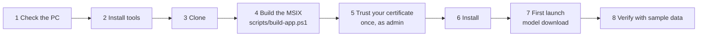

# Deployment guide: from `git clone` to a running app

This guide takes you from nothing to a running app, step by step. It works for every app in `apps/`. Example used throughout: **LocalMind**. Replace `LocalMindApp` with the folder you want.



## 1. Check the PC

| Need | How to check |
|---|---|
| Windows 11, build **22621 or later**, x64 | `winver` (or `[Environment]::OSVersion.Version` in PowerShell) |
| For the AI features: a PC that supports the Windows AI APIs, i.e. a **Copilot+ PC with an NPU** | Settings → System → About; the app's status pill shows *On-device model: ready* (or an explanation) at first launch |
| Free disk space: each MSIX is ~90 MB (the Windows App SDK is bundled), plus the NuGet cache | |
| Developer Mode is **not** required (we sideload a signed MSIX) | |

On a PC without a supported NPU the apps still start and the non-AI parts work; anything that needs Phi Silica / OCR / image description reports that the model is unavailable.

## 2. Install the tools

```powershell
winget install --id Microsoft.DotNet.SDK.8      # or any newer .NET SDK (the build was tested with SDK 9.0 targeting net8.0)
winget install --id Git.Git
```

You do **not** need Visual Studio. The Windows SDK build tools (`Microsoft.Windows.SDK.BuildTools`) and the Windows App SDK (`2.2.2-experimental9`) are restored from NuGet by the build; the first build downloads them (a few hundred MB).

Check:

```powershell
dotnet --list-sdks
git --version
```

## 3. Get the code

```powershell
git clone https://github.com/medyabi/windows-local-ai-apps.git
cd windows-local-ai-apps
```

(The repository is private. Clone from an account that has access, e.g. after `gh auth login`.)

## 4. Build the MSIX

One command; it never edits files in the repository (it builds a temporary copy):

```powershell
.\scripts\build-app.ps1 -App LocalMindApp
```

What it does:

1. Verifies .NET is installed.
2. Looks in `Cert:\CurrentUser\My` for a code-signing certificate named `CN=OnDeviceAIApps` and **creates a self-signed one** (valid 3 years) if there is none. Use `-Subject "CN=Your Name"` for a different name, or `-Thumbprint <value>` to reuse an existing certificate.
3. Copies the app to `%TEMP%\build-LocalMindApp` and patches **two values** in the copy: `PackageCertificateThumbprint` in the `.csproj` and `Publisher` in `Package.appxmanifest` (the two must match the certificate, otherwise signing or installation fails).
4. Runs the same `dotnet build` command as in [`BUILD.md`](BUILD.md).
5. Copies the result to `dist\LocalMindApp\` : the `.msix` and the **public** `.cer`. The private key never leaves your certificate store.

Expected: about 30 s to 2 min per app; a warning *"Path to `mspdbcmf.exe` could not be found. A symbols package will not be generated"* is harmless.

> Why not use the thumbprint that is in the repository? It belongs to the original author's certificate, which exists only on that PC. Build with your own.

## 5. Trust your certificate (once per PC)

Windows refuses to install an MSIX whose signer it does not trust. Open **PowerShell as administrator** and run:

```powershell
Import-Certificate -FilePath .\dist\LocalMindApp\LocalMindApp.cer -CertStoreLocation Cert:\LocalMachine\TrustedPeople
```

This trusts *that one certificate* for package installation; it does not add a root authority. Remove it later with `Get-ChildItem Cert:\LocalMachine\TrustedPeople | Where-Object Subject -eq 'CN=OnDeviceAIApps' | Remove-Item`.

## 6. Install

Either re-run the script with `-Install` (from an elevated PowerShell if step 5 has not been done yet):

```powershell
.\scripts\build-app.ps1 -App LocalMindApp -Install
```

or install the file you already built:

```powershell
Add-AppxPackage -Path .\dist\LocalMindApp\LocalMindApp_1.2.0.0_x64.msix
```

(The file name contains the app's version; use `dir dist\LocalMindApp`.)

The app now appears in the Start menu. To start it from a terminal: `Get-AppxPackage *LocalMind*` gives the *PackageFamilyName*; then `Start-Process "shell:AppsFolder\<PackageFamilyName>!App"`.

## 7. First launch

1. The status pill (top of the window) shows the on-device model state. The first time, Windows may need to **download or prepare the Phi Silica model**; this can take a few minutes and may need internet (Windows Update) the first time. Apps with image features (LocalMind: image generation, upscaling, background removal) download each Windows-managed model on first use.
2. Nothing else to configure for the on-device apps.
3. HybridMed and HybridMind only: enter *your own* cloud endpoint and key in their settings (see their READMEs). Without it they work in local-only mode.

## 8. Verify with the sample data

Each app's README ends with a "Try it" list that uses the synthetic files shipped in the app's sample folder. If nothing happens, open the log:

```powershell
notepad "$env:LOCALAPPDATA\Packages\$((Get-AppxPackage *LocalMind*).PackageFamilyName)\LocalState\bridge.log"
```

## Update, uninstall, clean up

```powershell
# update: build again (version bump in Package.appxmanifest if you want to keep both) then
Add-AppxPackage -Path .\dist\<App>\<file>.msix -ForceApplicationShutdown
# uninstall (also removes the app's data folder)
Get-AppxPackage *LocalMind* | Remove-AppxPackage
```

## Developer loop (fast iteration on the web UI)

The unpackaged `.exe` does not work (no package identity). Register a Debug build loosely instead, see [`BUILD.md`](BUILD.md) section 5. Most UI changes are only in `www/`; rebuild and re-register after editing.

## Troubleshooting

| Symptom | Cause / fix |
|---|---|
| `Add-AppxPackage`: *0x800B0109 / certificate chain processed but terminated in a root certificate which is not trusted* | Step 5 not done (or done in a non-elevated shell, or for another certificate). Re-import the `.cer` into `Cert:\LocalMachine\TrustedPeople`. |
| `0x80073CF3 / package could not be registered` mentioning *publisher* | The package is already installed but signed by a different publisher (e.g. you built with a new subject). `Remove-AppxPackage` the old one first. |
| Build fails during **restore** (NU1101 / "unable to find package") | The PC cannot reach nuget.org. The first build needs internet to download the Windows App SDK and the build tools. |
| Build error *"The specified certificate… was not found" / signing failed* | The thumbprint in the work copy is not in `Cert:\CurrentUser\My`. Let the script create/choose the certificate; do not build from the repository folder directly. |
| App window opens but is blank | WebView2 runtime missing (rare on Windows 11): `winget install Microsoft.EdgeWebView2Runtime`. Check `bridge.log`. |
| Status pill says the model is **not ready** / unavailable | The PC does not support the Windows AI APIs, the model is still downloading, or Windows is not up to date. Run Windows Update and wait. |
| Model answers are **empty** with no error | Windows content moderation refused the prompt. See [`WINDOWS-AI-LESSONS.md`](WINDOWS-AI-LESSONS.md). |
| Local-index apps (Fraud, POE Verification, HR, LocalIQ, LocalMind) find nothing right after indexing | The index is **asynchronous**; wait a few seconds and retry (the apps already retry). |
| POE Photo Processor: face detection never starts | It loads *face-api.js* and its model files from a CDN, so it needs internet (see the network table in the main README). |

## Distributing to other PCs

Give them the `.msix` **and** the `.cer`, and have them do step 5 and `Add-AppxPackage`. For wider distribution, sign with a certificate from a trusted CA instead of a self-signed one, or publish through the Microsoft Store.
